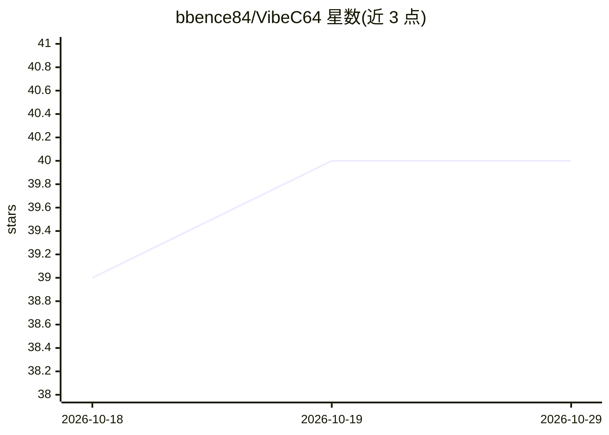

# bbence84/VibeC64

⭐ 40 · Python · MIT · 推送 2026-02-08 · [GitHub](https://github.com/bbence84/VibeC64) · [官网](https://vibec64.super-duper.xyz/) · 个人维护

**AI agent：从创意生成 Commodore 64 BASIC 游戏并测试**

基于 LangChain 构建的 C64 游戏创作 agent：用户提供游戏概念，agent 生成设计文档、产出 BASIC V2.0 代码，经 LLM 与规则双层语法校验迭代修正，转换为 PRG 格式供下载或在模拟器运行。可选接入真实 C64 硬件（KungFu Flash、C64U REST API、自定义键盘设备、视频采集），agent 可自动游玩测试。支持 Google AI/Anthropic/OpenAI/OpenRouter 多家 LLM 提供商，提供 Chainlit Web UI 与 CLI 双界面。自述为 BETA，硬件集成实验性。

## 筛选速览

| 维度 | 判定 | 备注 |
|---|---|---|
| AI 角色 | `ai-native` | 本体是模型或模型工具 |
| 许可风险 | `permissive` | MIT |
| 部署形态 | `library` | 以包/库形式分发 |
| 模型依赖 | locked-api |  |
| 硬件要求 | — | 无带数字的原话,不猜 |
| 安装摩擦 | `low` | 无编译、无系统依赖或容器化 |
| 成熟度 | `idea` | |

## 能力要点

- 从创意到 BASIC 代码的完整生成-校验-修正循环
- 可选真实 C64 硬件集成（KungFu Flash/C64U/键盘控制/屏幕采集）
- 支持 Google AI、Anthropic、OpenAI、OpenRouter 四类 LLM 提供商，运行时可切换模型
- Web UI 与 CLI 双界面，生成文件可下载或直接在在线模拟器运行

## 适用场景

- 用自然语言描述创意，让 AI 生成可运行的 C64 游戏
- 在真实 C64 硬件上加载并自动测试生成的程序
- 生成 C64 BASIC 代码作为学习或复古开发起点

## 场景标签

`代码生成` `编码 Agent` · 领域:编码与开发

## 证据(README 行号)

> L5: VibeC64 is an AI agent specialized in creating games for the Commodore 64 computer using BASIC V2.0. It leverages mo
> L12: - **Automatic Code Generation**: Generates syntactically correct C64 BASIC V2.0 code
> L133: - **CreateUpdateC64BasicCode**: Generates or modifies C64 BASIC code based on design plans

## 星数曲线

2026-10-18 39 → 2026-10-29 40（+1）

---
*卡片 v1 · prompt 1.4 · 生成 2026-10-25 · 置信度 mid · 依据 README sha `1d6b82108790` · [字段定义](../../DATASET.md)*
