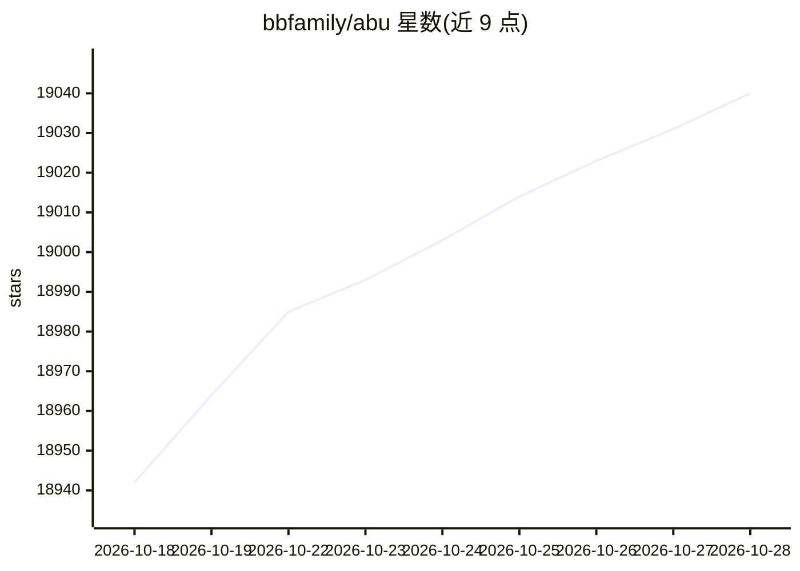

# bbfamily/abu

⭐ 19,040 · Python · GPL-3.0 · 推送 2026-10-16 · [GitHub](https://github.com/bbfamily/abu) · [官网](http://www.abuquant.com/) · 个人维护 · 中文 README

**给量化投资者的Python回测与策略开发框架**

基于 Python 的开源量化交易系统，源代码在 abupy 目录，配套教程目录与非编程界面（abupy_ui）。支持美股、A股、港股、期货、期权、比特币/莱特币市场的回测与选股、择时策略开发，内置缠论、波浪、谐波、K线形态、均线等信号体系与上百种子量化模型，并包含机器学习模块（AbuMLPd）与自定义数据源接入。推荐 Anaconda 部署，教程以 ipynb 形式提供，License 为 GPL。

## 筛选速览

| 维度 | 判定 | 备注 |
|---|---|---|
| AI 角色 | `ai-enhanced` | 去掉 AI 部分产品仍成立 |
| 许可风险 | `viral` | GPL-3.0 |
| 部署形态 | `None` |  |
| 模型依赖 | — | README 未给出锁定关系 |
| 硬件要求 | — | 无带数字的原话,不猜 |
| 安装摩擦 | `low` | 无编译、无系统依赖或容器化 |
| 成熟度 | — | 结构信号不足 |

## 动量与使用信号

- 维护:`active` — 距上次 push 1.9 天,年发版 0,2 位贡献者
- 涨星:近 1 天 **+11**(自 20261016 起算)
- 下载:GitHub Release 附件 累计 3,868(1 个 release)

## 能力要点

- 支持美股/A股/港股/期货/期权/比特币等多市场回测
- 内置缠论、波浪、谐波、K线形态、均线等多种信号体系
- 内置机器学习模块并支持策略参数 Grid Search 评分
- 提供非编程界面 abupy_ui 与 19 节 ipynb 教程

## 适用场景

- 我需要用 Python 对 A股/美股/港股策略做历史回测
- 我想开发并优化自己的择时、选股因子
- 我需要在比特币、期货等品种上验证交易策略

## 场景标签

`金融量化` `教程课程` · 领域:学习与行业

## 证据(README 行号)

> L5: |阿布量化系统源代码|abupy目录|
> L118: * 使用多种机器学习技术智能优化策略
> L123: * 美股，A股，港股

## 星数曲线

2026-10-18 18,942 → 2026-10-28 19,040（+98）

---
*卡片 v1 · prompt 1.4 · 生成 2026-10-18 · 置信度 high · 依据 README sha `137d35e2e264` · [字段定义](../../DATASET.md)*
