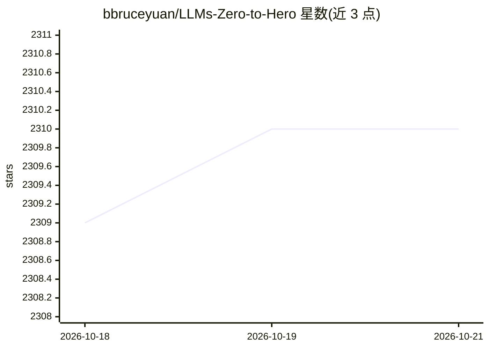

# bbruceyuan/LLMs-Zero-to-Hero

⭐ 2,312 · Jupyter Notebook · Apache-2.0 · 推送 2026-10-14 · [GitHub](https://github.com/bbruceyuan/LLMs-Zero-to-Hero) · [官网](https://yuanchaofa.com/llms-zero-to-hero/) · 个人维护 · 中文 README

**从零手写 LLM 的中文教程仓库（笔记+Notebook+视频）**

个人维护的大模型学习教程仓库：以章节形式从零手写 nanoGPT、MOE、DeepSeek-MLA、GRPO 等内容，每章配文章解读、可直接运行的中文 Notebook 与 B 站/YouTube 视频讲解，目标汇集成一本书。配套 Featurize 租用 GPU 镜像做训练演示，声明最小 3090、4090 可训练。内容通过个人博客、公众号与 B 站发布。注意 README 含作者自营 API 路由、算力平台与 Renoise 产品的推广链接。

## 筛选速览

| 维度 | 判定 | 备注 |
|---|---|---|
| AI 角色 | `ai-knowledge` | 知识聚合/清单类 |
| 许可风险 | `permissive` | Apache-2.0 |
| 部署形态 | `None` |  |
| 模型依赖 | — | README 未给出锁定关系 |
| 硬件要求 | — | 无带数字的原话,不猜 |
| 安装摩擦 | `low` | 无编译、无系统依赖或容器化 |
| 成熟度 | — | 结构信号不足 |

## 能力要点

- 章节化教程：nanoGPT / MOE / DeepSeek-MLA / GRPO 等主题的从零实现
- 每章配套中文可运行 Notebook 与 B 站/YouTube 视频讲解
- 配套租用 GPU 镜像用于模型训练与 Demo 演示，最小 3090/4090 可训练
- 正在编写成书，内容同步于个人博客与公众号

## 适用场景

- 系统学习 LLM 核心算法的从零实现
- 跟随中文 Notebook 与视频动手复现 nanoGPT、MLA、GRPO 等内容
- 了解从传统 RAG 到 Agentic RAG 的实现路线

## 场景标签

`教程课程` · 领域:学习与行业

## 证据(README 行号)

> L16: - 完全从零手写，边写边讲知识点，致敬 Andrej Karpathy
> L31: |章节|文章解读|中文 Notebook 复制后可直接运行|视频讲解 (可点击)|

## 星数曲线

2026-10-18 2,309 → 2026-10-21 2,310（+1）

---
*卡片 v1 · prompt 1.4 · 生成 2026-10-21 · 置信度 high · 依据 README sha `b794158fd287` · [字段定义](../../DATASET.md)*
