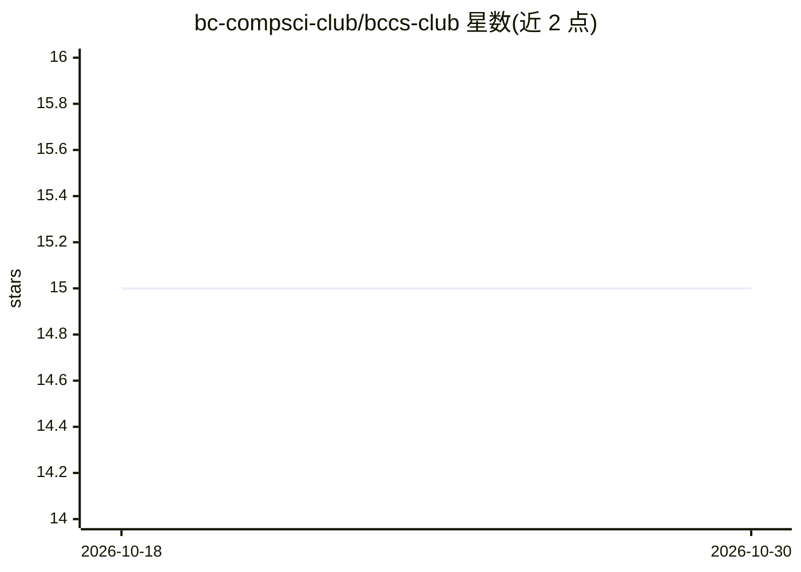

# bc-compsci-club/bccs-club

⭐ 15 · TypeScript · 推送 2026-02-03 · [GitHub](https://github.com/bc-compsci-club/bccs-club) · [官网](https://bccs.club) · 组织维护

**布鲁克林学院计算机科学俱乐部官网**

布鲁克林学院计算机科学俱乐部的开源网站项目。前端使用 TypeScript、Next.js（React）、Tailwind CSS；后端使用 Java 与 Spring Boot；数据库为 PostgreSQL；部署采用 Docker 与 Linux，CI/CD 使用 GitHub Actions。面向 BC 社区成员，README 声明欢迎社区成员按贡献指南参与贡献。README 仅列出技术栈与贡献说明，未描述具体功能与安装运行步骤。

## 筛选速览

| 维度 | 判定 | 备注 |
|---|---|---|
| AI 角色 | `ai-ecosystem` | LLM/agent 周边工具 |
| 许可风险 | `none` | — |
| 部署形态 | `None` |  |
| 模型依赖 | — | README 未给出锁定关系 |
| 硬件要求 | — | 无带数字的原话,不猜 |
| 安装摩擦 | `low` | 无编译、无系统依赖或容器化 |
| 成熟度 | — | 结构信号不足 |

## 能力要点

- Next.js + React + TypeScript + Tailwind CSS 前端技术栈
- Java Spring Boot 后端与 PostgreSQL 数据库
- Docker + Linux 部署，GitHub Actions 做 CI/CD

## 适用场景

- 查看俱乐部网站源码并参与贡献
- 作为高校社团网站项目参考其技术栈组织方式

## 场景标签

 · 领域:教育/社区网站

## 证据(README 行号)

> L1: # Brooklyn College Computer Science Club Website
> L22: The BC Computer Science Club website is an open source project and everyone in the BC community is welcome to contr

## 星数曲线

2026-10-18 15 → 2026-10-30 15（+0）

---
*卡片 v1 · prompt 1.4 · 生成 2026-10-30 · 置信度 low · 依据 README sha `b0140b6f6a88` · [字段定义](../../DATASET.md)*
