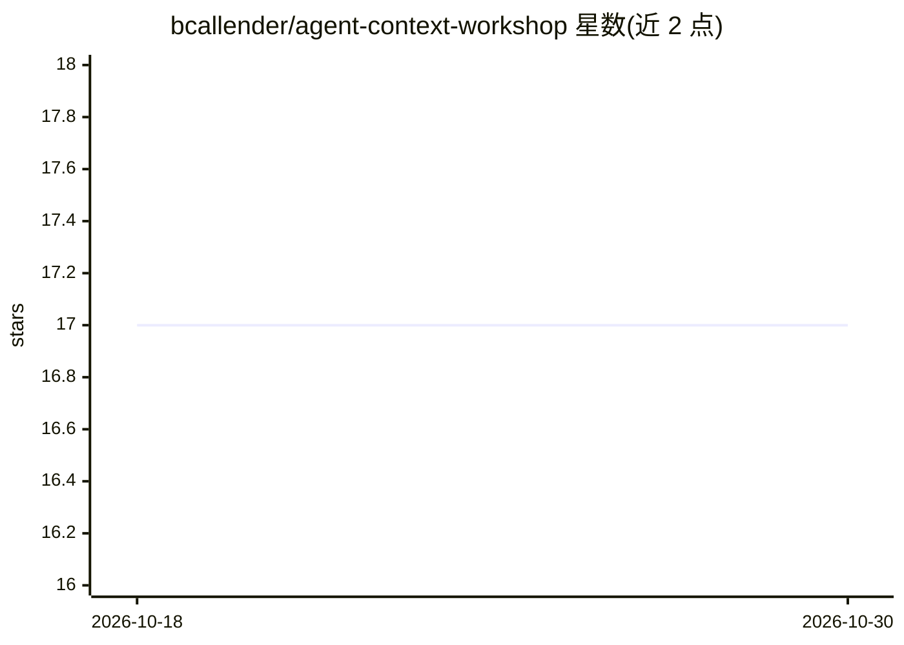

# bcallender/agent-context-workshop

⭐ 17 · Rust · Apache-2.0 · 推送 2026-06-29 · [GitHub](https://github.com/bcallender/agent-context-workshop) · 个人维护

**面向编码 agent 的上下文层工作坊：构建代码知识图谱并实测效果**

AI Engineer World's Fair 2026 工作坊材料：以真实 Rust 代码库 qdrant 为例，用 tree-sitter、rustdoc JSON、fenic 三级阶梯提取代码结构为 Neo4j 知识图谱，为 agent 提供图查询工具（search、blast_radius、implementors 等），再在 30 个金标问题上对比图遍历 agent 与 grep agent。结果：单次准确率接近持平（21/30 vs 19/30），图谱在确定性、输入 token 效率与 agent 采纳率上更高。以 Jupyter notebook 形式提供，支持 Colab 运行。

## 筛选速览

| 维度 | 判定 | 备注 |
|---|---|---|
| AI 角色 | `ai-knowledge` | 知识聚合/清单类 |
| 许可风险 | `permissive` | Apache-2.0 |
| 部署形态 | `self-host` | docker 或自建部署 |
| 模型依赖 | locked-api |  |
| 硬件要求 | — | 无带数字的原话,不猜 |
| 安装摩擦 | `low` | 无编译、无系统依赖或容器化 |
| 成熟度 | — | 结构信号不足 |

## 能力要点

- 三级阶梯（语法/解析/语义）构建代码知识图谱
- 30 个金标问题的图 agent vs grep agent 对比评测
- 评测 notebook 无需 Docker 与 API key（缓存优先）
- 单一 OpenRouter key 可路由任意模型（AGENT_MODEL 环境变量）

## 适用场景

- 学习如何为编码 agent 构建代码知识图谱上下文层
- 复现图遍历与 grep 两种代码探索方式的对比评测
- 了解上下文工程 L1→L3 三个层次的实践差异

## 场景标签

`知识图谱` `教程课程` · 领域:知识与检索

## 证据(README 行号)

> L5: Most coding agents explore a codebase by grepping it. This workshop builds the alternative: a
> L6: **code knowledge graph** an agent can traverse instead — then runs an honest eval to see whether it
> L13: The honest result: on single-shot accuracy they roughly **tie** (graph 21/30, grep 19/30). The graph wins

## 星数曲线

2026-10-18 17 → 2026-10-30 17（+0）

---
*卡片 v1 · prompt 1.4 · 生成 2026-10-30 · 置信度 mid · 依据 README sha `381eae7f2a8f` · [字段定义](../../DATASET.md)*
