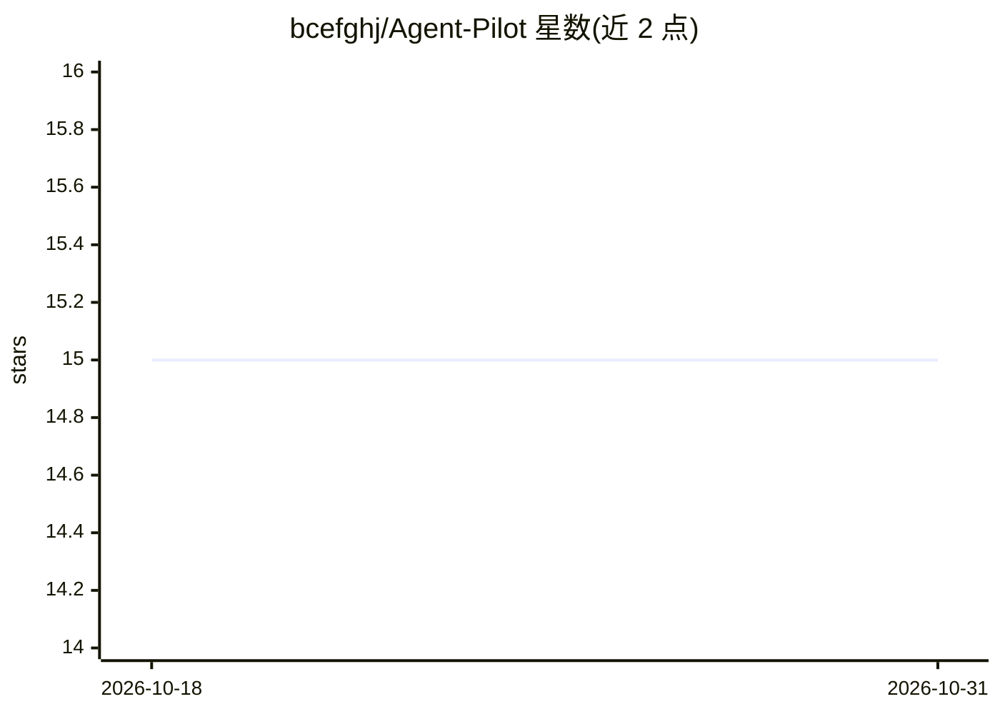

# bcefghj/Agent-Pilot

⭐ 15 · Python · MIT · 推送 2026-05-07 · [GitHub](https://github.com/bcefghj/Agent-Pilot) · [官网](http://8.136.98.175) · 组织维护 · 中文 README

**飞书 IM 触发的 6 Agent 管线：对话自动生成文档与 PPT**

面向飞书用户的办公协同助手：在 IM 中以自然语言触发，6 个 Agent（Intent/Planner/Research/Writer/Review/Builder）依次完成意图分类、大纲生成、MiniMax M2.7 tool calling 联网搜索、撰写、最多 3 轮自评迭代，最终经飞书 Doc API 与 python-pptx 交付文档/PPT。支持 Human-in-the-Loop 大纲确认、SSE Dashboard 实时可视化、反向 MCP Server 供 Cursor/Claude Desktop 调用。为飞书 AI 校园挑战赛参赛项目，提供本地开发、Docker 与服务器一键部署三种方式。

## 筛选速览

| 维度 | 判定 | 备注 |
|---|---|---|
| AI 角色 | `ai-native` | 本体是模型或模型工具 |
| 许可风险 | `permissive` | MIT |
| 部署形态 | `self-host` | docker 或自建部署 |
| 模型依赖 | — | README 未给出锁定关系 |
| 硬件要求 | — | 无带数字的原话,不猜 |
| 安装摩擦 | `low` | 无编译、无系统依赖或容器化 |
| 成熟度 | — | 结构信号不足 |

## 能力要点

- 6 Agent 流水线 + 共享 AgentState 编排（Intent→Planner→Research→Writer→Review→Builder）
- MiniMax M2.7 function calling 自主决定联网搜索
- 飞书 Doc API / CardKit / WebSocket Bot 集成，python-pptx 生成含演讲者备注的 PPT
- 反向 MCP Server 暴露工具给 Cursor / Claude Desktop

## 适用场景

- 在飞书群里一句话生成方案文档或 PPT
- 联网搜索后自动产出含数据的研究报告
- 在 IDE 中通过 MCP 调用其文档/PPT 生成工具

## 场景标签

`多智能体` `AI 写作` · 领域:Agent 开发

## 证据(README 行号)

> L3: > **从 IM 对话到演示稿的一键智能闭环** — 在飞书 IM 中通过自然语言触发，6 个专业 AI Agent（Intent / Planner / Research / Writer / Review / Builder）协
> L94: |**IntentAgent**|意图识别 · 任务分类（doc / ppt / trio / chat）|用户消息|`task_type` · `verdict`|
> L101: ### 2. MiniMax M2.7 Tool Calling 联网搜索

## 星数曲线

2026-10-18 15 → 2026-10-31 15（+0）

---
*卡片 v1 · prompt 1.4 · 生成 2026-10-30 · 置信度 high · 依据 README sha `e0479c538090` · [字段定义](../../DATASET.md)*
