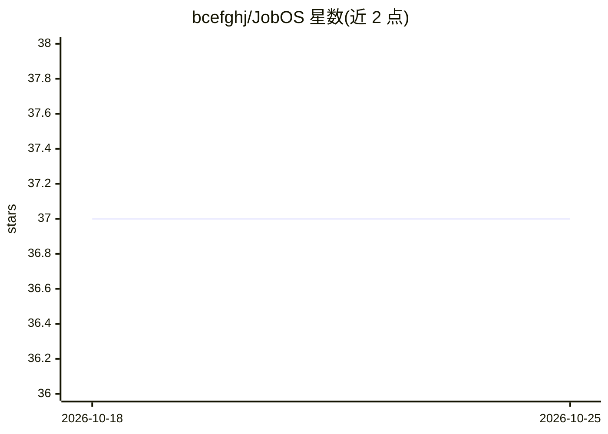

# bcefghj/JobOS

⭐ 37 · Python · 推送 2026-04-05 · [GitHub](https://github.com/bcefghj/JobOS) · 个人维护 · 中文 README

**面向求职者的 AI 求职操作系统：采集岗位、评分、生成简历与面试资料**

面向求职者的 Python 命令行工具链：以城市+关键词为输入，从 Boss直聘（4 级 fallback：boss-cli → DrissionPage 真实浏览器 → 手动 Cookie → 内置策展数据）、牛客网、猎聘采集岗位，SQLite 存储，按 10 个维度评分后导出带条件格式的 Excel；调用 MiniMax（OpenAI SDK 兼容，可换其他兼容 LLM）生成定制 LaTeX 简历、技能树、学习路径、八股文手册与模拟面试题。另提供 MCP Server 可接入 Cursor/Claude Code 用自然语言调用。需配置 LLM API Key，LaTeX 可不装（保留 .tex 源文件）。

## 筛选速览

| 维度 | 判定 | 备注 |
|---|---|---|
| AI 角色 | `ai-native` | 本体是模型或模型工具 |
| 许可风险 | `none` | — |
| 部署形态 | `library` | 以包/库形式分发 |
| 模型依赖 | — | README 未给出锁定关系 |
| 硬件要求 | — | 无带数字的原话,不猜 |
| 安装摩擦 | `low` | 无编译、无系统依赖或容器化 |
| 成熟度 | — | 结构信号不足 |

## 能力要点

- Boss直聘爬取 4 级 fallback 机制（boss-cli → DrissionPage → Cookie 导入 → 离线策展数据）
- 10 维岗位评分与带条件格式的 3 Sheet Excel 导出（含投递状态追踪）
- LLM 生成定制简历（YAML→Jinja2→XeLaTeX→PDF）与全套面试资料
- MCP Server 接入 Cursor/Claude Code，支持自然语言调用

## 适用场景

- 按城市和方向自动采集真实岗位并评分排序
- 针对目标 JD 生成定制 LaTeX 简历与面试准备资料
- 批量模式夜间自动运行并定时更新岗位数据

## 场景标签

`网页抓取` `AI 写作` · 领域:效率与自动化

## 证据(README 行号)

> L3: > **一句话介绍**：输入「城市 + 方向」，自动爬取 Boss直聘 + 牛客网 + 猎聘 真实岗位 → 10维评分 → 导出 Excel → 生成定制简历(LaTeX PDF) → 生成从零到面试的全套资料，一条龙服务。
> L363: |**定制简历**|YAML个人数据 + AI按JD关键词定制 + STAR法则润色 + ATS优化 + LaTeX PDF|

## 星数曲线

2026-10-18 37 → 2026-10-25 37（+0）

---
*卡片 v1 · prompt 1.4 · 生成 2026-10-25 · 置信度 high · 依据 README sha `903483fbc11d` · [字段定义](../../DATASET.md)*
