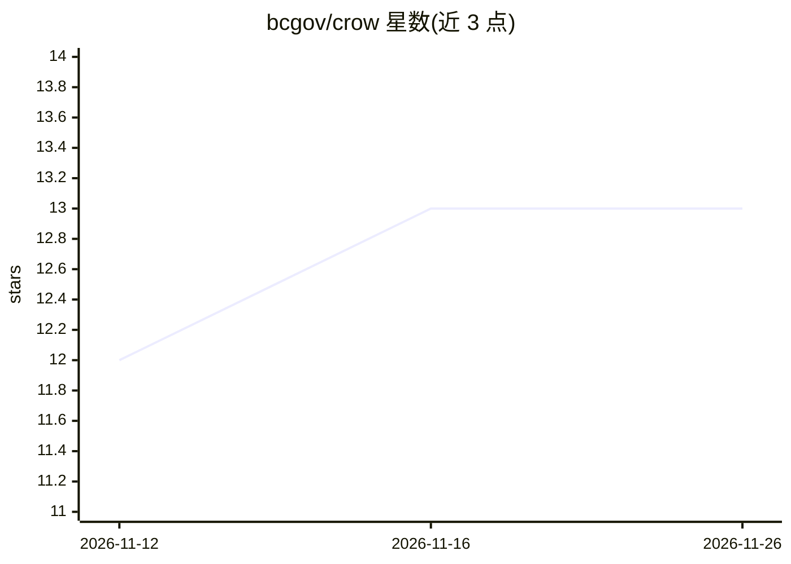

# bcgov/crow

⭐ 13 · PowerShell · MIT · 推送 2026-11-22 · [GitHub](https://github.com/bcgov/crow) · 组织维护

**面向开发者的 agentic 软件开发 agents/skills 软件包**

CROW（Continuous Remediation & Optimization Workflows）是 bcgov（不列颠哥伦比亚省政府）发布的 agents 与 skills 集合，覆盖 Java/.NET/PHP CI 流水线、框架与依赖维护、无障碍政府 UX、分析设计、安全审查与修复、数据建模、代码审查、测试等软件开发环节。通过 APM（Agent Package Manager）分发，支持安装到 Copilot、Claude、Codex、Cursor 等客户端，并提供 Getting Started Agent 引导按需选择能力；Raven Setup Agent 可配置 MCP 服务器。输出经宿主客户端执行，本地提示引导不依赖 Raven。

## 筛选速览

| 维度 | 判定 | 备注 |
|---|---|---|
| AI 角色 | `ai-native` | 本体是模型或模型工具 |
| 许可风险 | `permissive` | MIT |
| 部署形态 | `library` | 以包/库形式分发 |
| 模型依赖 | — | README 未给出锁定关系 |
| 硬件要求 | — | 无带数字的原话,不猜 |
| 安装摩擦 | `medium` | 含编译或系统依赖之一 |
| 成熟度 | — | 结构信号不足 |

## 能力要点

- 包含约 20 个 agents 与 20+ skills，覆盖 CI、架构、安全、测试、数据建模等开发环节
- 通过 APM 安装，一条命令切换 copilot/claude/codex/cursor 等目标客户端
- Getting Started Agent 面谈式选择能力并生成可复制提示词
- #stable 与精确版本标签两种更新锚定方式

## 适用场景

- 为 Java/.NET/PHP 项目搭建或评估 GitHub Actions/Azure Pipelines/Jenkins CI
- 对遗留系统做现代化改造与安全依赖审查
- 按 B.C. Design System 与 WCAG 2.2 AA 做无障碍 UX 设计
- 为数据模型编写带 B.C. 分类的文档与验证

## 场景标签

`Agent 框架` `代码审查` · 领域:Agent 开发

## 证据(README 行号)

> L3: CROW is a public package of agents and skills for agentic software
> L10: Crow is distributed through the [Agent Package Manager (APM)][APM] and as a
> L105: - Claude Code or Cursor: select the `crow-getting-started` skill with `/`.

## 星数曲线

2026-11-12 12 → 2026-11-26 13（+1）

---
*卡片 v1 · prompt 1.4 · 生成 2026-11-18 · 置信度 mid · 依据 README sha `e6f96a8c4bdd` · [字段定义](../../DATASET.md)*
