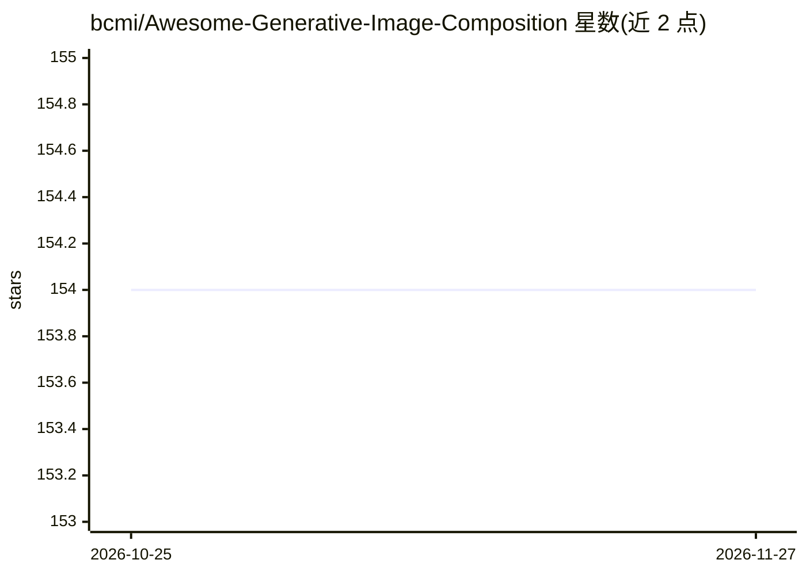

# bcmi/Awesome-Generative-Image-Composition

⭐ 154 · Python · 推送 2026-11-10 · [GitHub](https://github.com/bcmi/Awesome-Generative-Image-Composition) · 组织维护

**生成式图像合成（物体插入）论文与数据集清单**

以列表形式整理生成式图像合成（object insertion）领域资源，定义该任务为基于背景图（可选包围框）与前景对象图像生成合理合成图。内容按综述、在线演示、评测指标、数据集（9 个）、论文（Training-free 与 Training-based 分类）组织，多数论文条目附 arXiv、出版页与代码链接。面向图像合成方向的研究者查找文献、数据与实现。

## 筛选速览

| 维度 | 判定 | 备注 |
|---|---|---|
| AI 角色 | `ai-knowledge` | 知识聚合/清单类 |
| 许可风险 | `none` | — |
| 部署形态 | `None` |  |
| 模型依赖 | — | README 未给出锁定关系 |
| 硬件要求 | — | 无带数字的原话,不猜 |
| 安装摩擦 | `low` | 无编译、无系统依赖或容器化 |
| 成熟度 | — | 结构信号不足 |

## 能力要点

- 按 Training-free / Training-based 分类整理论文条目，附代码与出版链接
- 收录 9 个数据集，覆盖单参考/多参考、域内/跨域设定
- 附综述链接与基于 libcom 的在线演示入口

## 适用场景

- 进入图像合成领域时系统查找相关论文与代码
- 为研究选择合适的评测数据集（如 MureCom、AnyInsertion）
- 了解物体插入方法的分类脉络

## 场景标签

`精选清单` `科研工具` · 领域:学习与行业

## 证据(README 行号)

> L3: A curated list of resources including papers, datasets, and relevant links pertaining to generative image compositio
> L36: ## Papers
> L49: ### Training-based

## 星数曲线

2026-10-25 154 → 2026-11-27 154（+0）

---
*卡片 v1 · prompt 1.4 · 生成 2026-11-27 · 置信度 high · 依据 README sha `234c9b982e63` · [字段定义](../../DATASET.md)*
