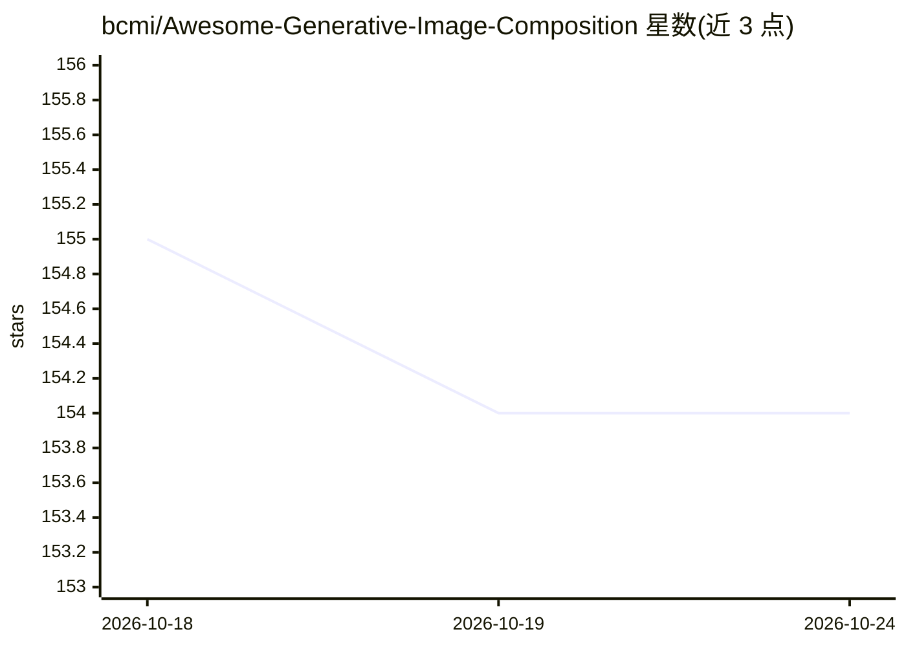

# bcmi/Awesome-Generative-Image-Composition

⭐ 154 · Python · 推送 2026-09-25 · [GitHub](https://github.com/bcmi/Awesome-Generative-Image-Composition) · 组织维护 · 中文 README

**生成式图像合成/物体插入方向的论文与数据集策展清单**

由 bcmi 维护的 awesome list，收录生成式图像合成（物体插入）方向的综述论文、在线 demo、评测指标、9 个数据集（MureCom、COCOEE、AnyInsertion、DreamFuse 等）及按 Training-free / Training-based 分类的论文条目，每条含论文链接与部分代码仓库链接。面向该方向的研究者与开发者，用于跟踪方法与基准。清单本身不含代码，安装与运行依赖各条目自带的仓库。另引导读者至 Awesome-Image-Composition 获取更完整的通用图像合成资源。

## 筛选速览

| 维度 | 判定 | 备注 |
|---|---|---|
| AI 角色 | `ai-knowledge` | 知识聚合/清单类 |
| 许可风险 | `none` | — |
| 部署形态 | `None` |  |
| 模型依赖 | — | README 未给出锁定关系 |
| 硬件要求 | — | 无带数字的原话,不猜 |
| 安装摩擦 | `low` | 无编译、无系统依赖或容器化 |
| 成熟度 | — | 结构信号不足 |

## 能力要点

- 收录综述、在线 demo、评测指标与 9 个数据集条目
- 论文按 Training-free 与 Training-based 分类组织
- 多数条目附 arXiv/正式论文及开源代码链接

## 适用场景

- 查找物体插入方向的最新论文与开源实现
- 为模型训练与评测挑选合适数据集和基准
- 了解生成式图像合成的评测指标与在线 demo

## 场景标签

`精选清单` `图像生成` · 领域:内容生成

## 证据(README 行号)

> L7: A curated list of resources including papers, datasets, and relevant links pertaining to generative image compositio
> L29: ## Datasets
> L42: ### Training-free (2026

## 星数曲线

2026-10-18 155 → 2026-10-24 154（-1）

---
*卡片 v1 · prompt 1.4 · 生成 2026-10-22 · 置信度 high · 依据 README sha `8037c5b34403` · [字段定义](../../DATASET.md)*
