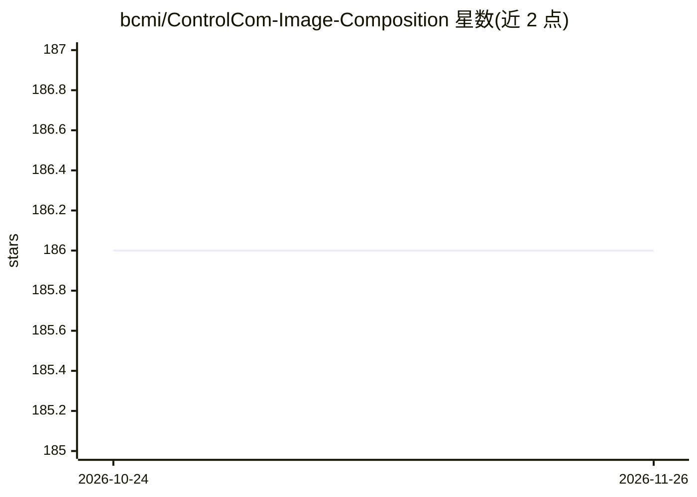

# bcmi/ControlCom-Image-Composition

⭐ 186 · Python · MIT · 推送 2026-11-10 · [GitHub](https://github.com/bcmi/ControlCom-Image-Composition) · 组织维护 · 中文 README

**可控图像合成模型：统一混合/协调/视角合成/生成式合成四任务**

论文 ControlCom 的官方代码库，基于 Stable Diffusion 构建的可控图像合成模型，用二维二元指示向量在单一模型中统一四个任务：图像混合 (0,0)、图像协调 (1,0)、视角合成 (0,1)、生成式合成 (1,1)，可选地调整前景的光照与位姿以适配背景。提供 FOSCom 数据集（640 对背景-前景）与两个微调检查点，含推理脚本与训练代码（部分公司内信息已移除）。面向研究者，提供在线 demo 与评测代码。

## 筛选速览

| 维度 | 判定 | 备注 |
|---|---|---|
| AI 角色 | `ai-native` | 本体是模型或模型工具 |
| 许可风险 | `permissive` | MIT |
| 部署形态 | `library` | 以包/库形式分发 |
| 模型依赖 | — | README 未给出锁定关系 |
| 硬件要求 | — | 无带数字的原话,不猜 |
| 安装摩擦 | `low` | 无编译、无系统依赖或容器化 |
| 成熟度 | — | 结构信号不足 |

## 能力要点

- 二维指示向量在单一模型中统一四种图像合成任务
- 提供 blending/harmonization 与 view/composition 两个专用检查点
- FOSCom 数据集（640 对）提供 Dropbox 与百度网盘下载
- 基于 libcom toolbox 提供在线 demo

## 适用场景

- 把前景物体插入背景并按需协调光照
- 改变插入物体的视角以适配背景
- 复现论文实验或训练自己的合成模型

## 场景标签

`图像生成` · 领域:内容生成

## 证据(README 行号)

> L19: **In our controllable image composition model, we unify four tasks in one model using an 2-dim binary indicator vec
> L29: Our method is built upon stable diffusion and the network architecture is shown as follows.

## 星数曲线

2026-10-24 186 → 2026-11-26 186（+0）

---
*卡片 v1 · prompt 1.4 · 生成 2026-11-26 · 置信度 high · 依据 README sha `df227e3e215a` · [字段定义](../../DATASET.md)*
