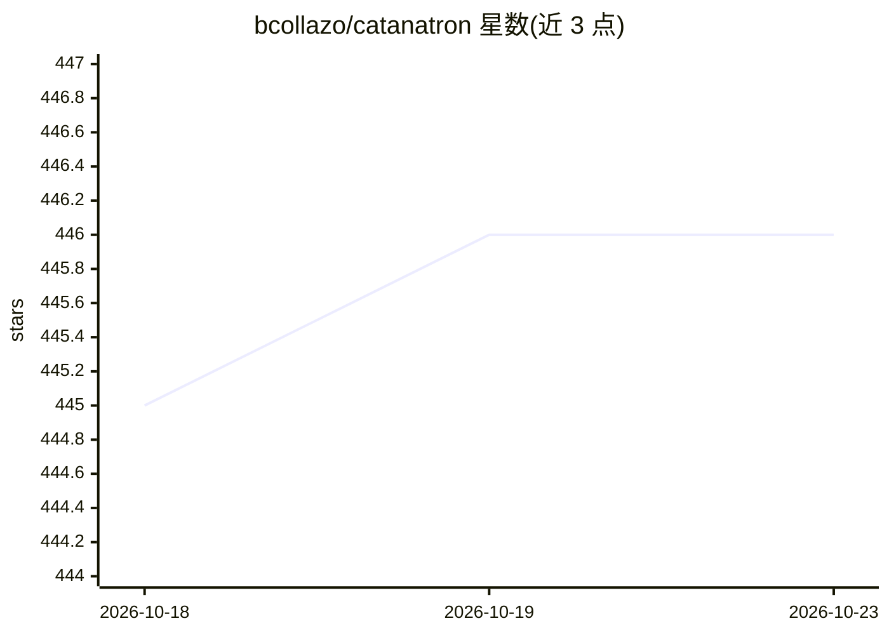

# bcollazo/catanatron

⭐ 446 · Python · GPL-3.0 · 推送 2026-09-16 · [GitHub](https://github.com/bcollazo/catanatron) · [官网](https://docs.catanatron.com) · 个人维护

**卡坦岛（Settlers of Catan）游戏模拟器与 AI 机器人**

提供卡坦岛游戏的核心逻辑实现，可在数秒内运行数千局对局模拟，目标是寻找最强的卡坦岛机器人。提供 catanatron-play CLI 运行大规模模拟并生成 JSON 等格式的数据集；提供 Docker 镜像与 Web UI 供观战、检视和人对战；Python 库可嵌入使用，并附带 OpenAI Gymnasium 环境接口用于强化学习。需 Python 3.11 或更高版本，从源码克隆安装。

## 筛选速览

| 维度 | 判定 | 备注 |
|---|---|---|
| AI 角色 | `ai-native` | 本体是模型或模型工具 |
| 许可风险 | `viral` | GPL-3.0 |
| 部署形态 | `self-host` | docker 或自建部署 |
| 模型依赖 | — | README 未给出锁定关系 |
| 硬件要求 | — | 无带数字的原话,不猜 |
| 安装摩擦 | `low` | 无编译、无系统依赖或容器化 |
| 成熟度 | — | 结构信号不足 |

## 能力要点

- 数秒内运行数千局卡坦岛对局模拟
- CLI 批量对局并生成 JSON 格式数据集
- Docker + Web UI 观战、检视与人对战
- 提供 Gymnasium 强化学习环境接口

## 适用场景

- 大规模对局模拟评估卡坦岛机器人强度
- 生成对局数据集做分析或训练
- 通过 Web UI 与 AI 机器人对战
- 用 Gymnasium 接口做强化学习实验

## 场景标签

`强化学习` · 领域:训练与推理

## 证据(README 行号)

> L8: Catanatron is a high-performance simulator and strong AI player for Settlers of Catan. You can run thousands of game
> L94: For Reinforcement Learning, catanatron provides an Open AI / Gymnasium Environment.

## 星数曲线

2026-10-18 445 → 2026-10-23 446（+1）

---
*卡片 v1 · prompt 1.4 · 生成 2026-10-21 · 置信度 high · 依据 README sha `54fa6f17b742` · [字段定义](../../DATASET.md)*
