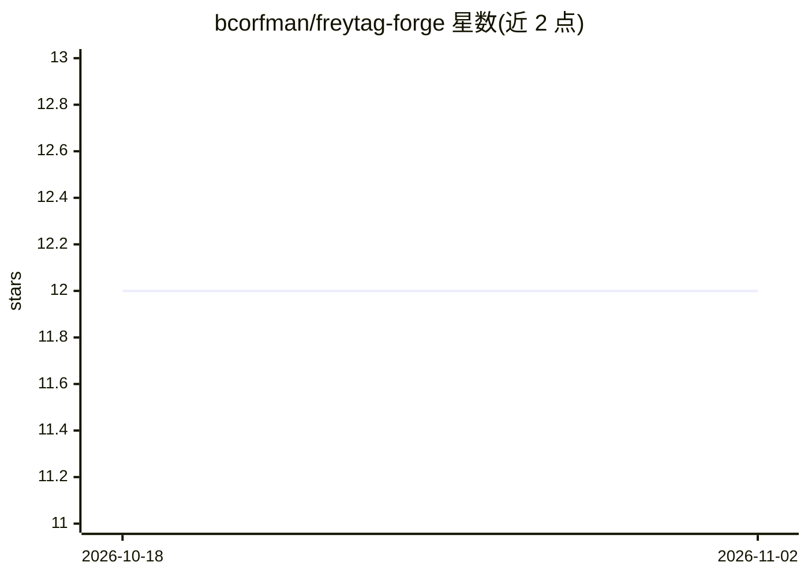

# bcorfman/freytag-forge

⭐ 12 · Python · MIT · 推送 2026-11-01 · [GitHub](https://github.com/bcorfman/freytag-forge) · [官网](https://bcorfman.github.io/freytag-forge/) · 个人维护

**基于 LLM 叙事与事实校验世界模型的自由文字冒险引擎**

开放式的交互式小说/文字冒险引擎：玩家输入任意文字，由 LLM 叙述者生成行动结果；引擎维护名词级世界模型（实体、位置、状态），作为裁判校验事实——隐藏物品不可提前拿取、新增事物成为可返回的真实对象、同伴与携带物随玩家移动，并由作者撰写的 Markdown 剧本驱动有弧线的剧情与按行动解锁的秘密。面向玩家（浏览器游玩）与作者（Markdown 写作）及贡献者（Python 3.12+ / uv，含 90% 覆盖率门槛的测试套件）。

## 筛选速览

| 维度 | 判定 | 备注 |
|---|---|---|
| AI 角色 | `ai-native` | 本体是模型或模型工具 |
| 许可风险 | `permissive` | MIT |
| 部署形态 | `None` |  |
| 模型依赖 | — | README 未给出锁定关系 |
| 硬件要求 | — | 无带数字的原话,不猜 |
| 安装摩擦 | `low` | 无编译、无系统依赖或容器化 |
| 成熟度 | — | 结构信号不足 |

## 能力要点

- 自由输入：无动词表，LLM 叙述者生成任意行动的结果
- 世界模型作为裁判：追踪实体/位置/状态，拒绝与事实冲突的行动
- 作者用 Markdown 声明世界，剧本具备剧情弧线与按行动解锁的秘密
- 时间流逝机制：延迟行动产生真实代价，破坏剧情的行动会先警告

## 适用场景

- 玩自由输入、剧情由引擎把关的文字冒险
- 作者用 Markdown 编写可被任意输入探索的交互式剧本
- 在支持 LLM 的托管环境运行自定义故事

## 场景标签

 · 领域:游戏/交互式叙事

## 证据(README 行号)

> L6: - **Type anything.** No verb list, no "I don't understand that." A live narrator answers whatever you try.
> L19: Freytag Forge keeps the nouns and drops the verb list. The world model tracks what exists, where it is, and what st

## 星数曲线

2026-10-18 12 → 2026-11-02 12（+0）

---
*卡片 v1 · prompt 1.4 · 生成 2026-11-01 · 置信度 mid · 依据 README sha `be97e9630727` · [字段定义](../../DATASET.md)*
