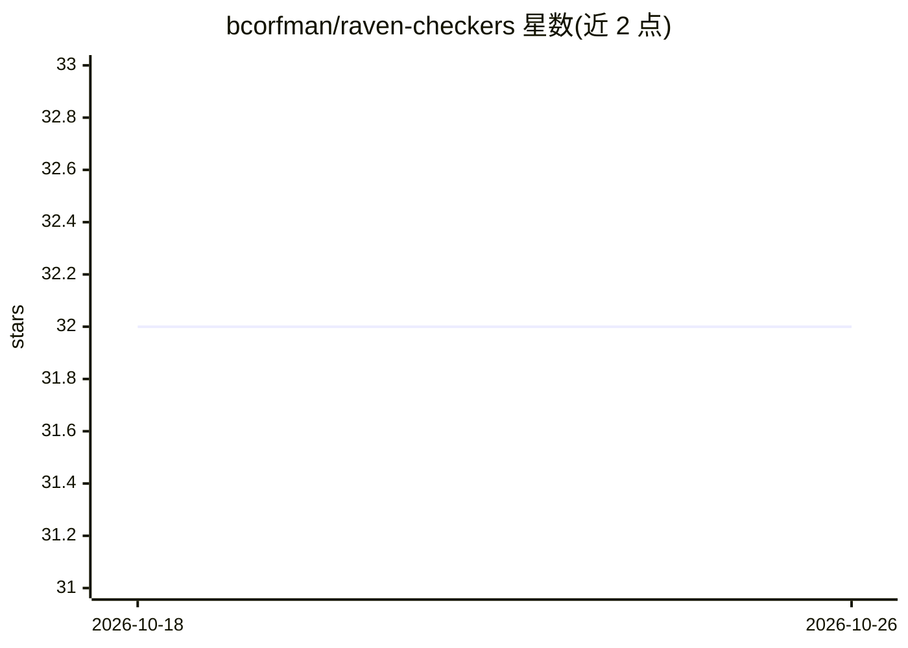

# bcorfman/raven-checkers

⭐ 32 · Python · MIT-0 · 推送 2026-10-20 · [GitHub](https://github.com/bcorfman/raven-checkers) · 个人维护

**开源 Python 跳棋游戏，内置 AI 对手与棋局学习功能**

用 Python 和 Tkinter 编写的跳棋程序，支持单人（对 AI）或双人对弈，提供 Windows、Ubuntu 22 与 macOS ARM 版本下载。AI 引擎基于 Martin Fierz 的 Simple Checkers 评估函数与 Peter Norvig 的 AIMA 搜索代码，主题标签含 minimax 与 alpha-beta。功能上支持标准棋盘记号摆局、着法注释、保存/载入棋局及多局 PDN 文件载入，面向学习跳棋与基础 AI 算法的用户。需 Python 3.12+ 与 uv，通过 make 命令安装与运行。

## 筛选速览

| 维度 | 判定 | 备注 |
|---|---|---|
| AI 角色 | `ai-enhanced` | 去掉 AI 部分产品仍成立 |
| 许可风险 | `permissive` | MIT-0 |
| 部署形态 | `None` |  |
| 模型依赖 | — | README 未给出锁定关系 |
| 硬件要求 | — | 无带数字的原话,不猜 |
| 安装摩擦 | `medium` | 含编译或系统依赖之一 |
| 成熟度 | — | 结构信号不足 |

## 能力要点

- 单人（AI 对手）或双人模式，跨 Windows/macOS/Linux
- AI 引擎基于 Fierz 评估函数与 AIMA 搜索代码（minimax/alpha-beta）
- 标准记号摆局、着法注释、保存载入棋局与 PDN 多局文件支持
- 随附 training 目录的示例棋局与教程

## 适用场景

- 与内置 AI 对弈或双人对局
- 通过摆局与载入棋局学习跳棋战术
- 阅读源码学习基础 AI 搜索算法与 Python 应用设计

## 场景标签

 · 领域:游戏/桌面娱乐

## 证据(README 行号)

> L7: Raven is a checkers game program, for one or two players. (Windows, Ubuntu 22, and MacOS ARM downloads available.) W
> L9: * **Open-source code**. Raven uses existing open source code as a basis (Martin Fierz's Simple Checkers evaluation f

## 星数曲线

2026-10-18 32 → 2026-10-26 32（+0）

---
*卡片 v1 · prompt 1.4 · 生成 2026-10-26 · 置信度 high · 依据 README sha `ea35095e0e7c` · [字段定义](../../DATASET.md)*
