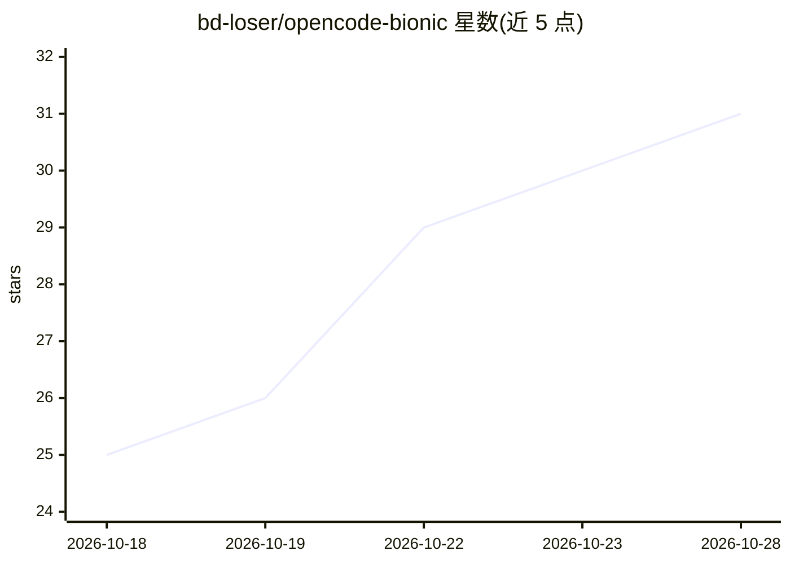

# bd-loser/opencode-bionic

⭐ 31 · Shell · MIT · 推送 2026-10-27 · [GitHub](https://github.com/bd-loser/opencode-bionic) · [官网](https://github.com/bd-loser/opencode-bionic#install) · 个人维护

**在 Android/Termux 上原生运行 opencode AI 编程代理的构建分发仓库**

为 anomalyco/opencode（终端 AI 编程代理）提供 Android Bionic aarch64 原生构建：修补 Bun 运行时、重建 opentui 原生库，打包为单个自包含 .deb，通过签名 apt 仓库以一条命令安装，无需 root/proot/chroot。提供 stable/beta/dev 三个通道，由每小时的上游监视器自动构建，每上游版本一个发布。仅支持 arm64-v8a，最低 Android 10。模型接入沿用上游（Anthropic、OpenAI、OpenAI 兼容端点）。面向想在手机上运行 opencode 的开发者。

## 筛选速览

| 维度 | 判定 | 备注 |
|---|---|---|
| AI 角色 | `ai-ecosystem` | LLM/agent 周边工具 |
| 许可风险 | `permissive` | MIT |
| 部署形态 | `library` | 以包/库形式分发 |
| 模型依赖 | local-ok | 支持本地模型 |
| 硬件要求 | — | 无带数字的原话,不猜 |
| 安装摩擦 | `low` | 无编译、无系统依赖或容器化 |
| 成熟度 | — | 结构信号不足 |

## 能力要点

- Bionic 原生单二进制，无 root/proot/chroot/glibc 依赖
- stable/beta/dev 三通道，小时级自动跟踪上游构建
- 签名 apt 仓库一键安装，pkg upgrade 持续更新
- bun-pty 重建支持终端会话（PTY）

## 适用场景

- 在 Android 手机 Termux 中原生运行 opencode AI 编程代理
- 在移动设备上配合本地或云端模型进行 AI 辅助编码
- 通过 apt 通道持续获取 opencode 的最新上游版本

## 场景标签

`编码 Agent` · 领域:编码与开发

## 证据(README 行号)

> L98: An open-source, terminal-based AI coding agent — MIT-licensed and
> L102: binaries for macOS, Linux, and Windows — **but none for Android**. This repo
> L156: All of upstream's: Anthropic, OpenAI, and any OpenAI-compatible endpoint

## 星数曲线

2026-10-18 25 → 2026-10-28 31（+6）

---
*卡片 v1 · prompt 1.4 · 生成 2026-10-26 · 置信度 mid · 依据 README sha `2d219a37b56d` · [字段定义](../../DATASET.md)*
