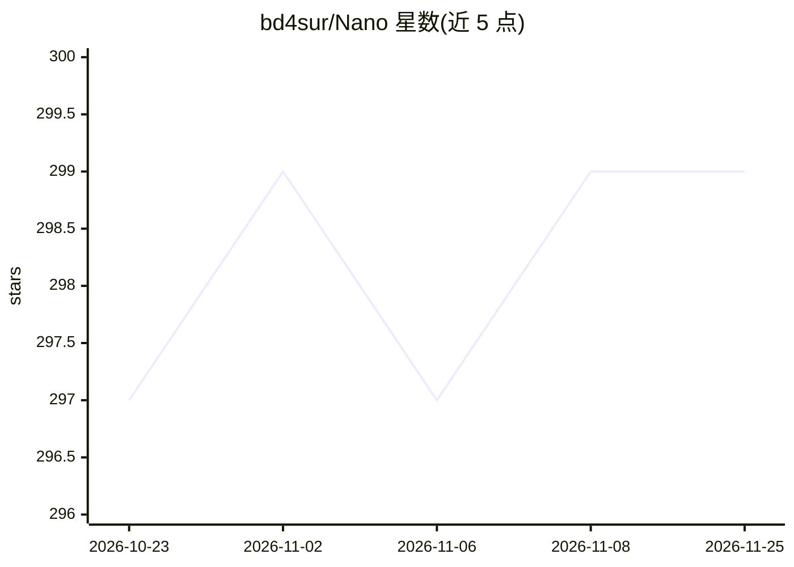

# bd4sur/Nano

⭐ 299 · C · 推送 2026-11-23 · [GitHub](https://github.com/bd4sur/Nano) · [官网](https://bd4sur.com/Nano/infer/web) · 个人维护 · 中文 README

**供个人学习与端侧部署实验的小型Transformer语言模型**

复刻自nanoGPT的Transformer语言模型项目，覆盖预训练、监督微调（全参数与LoRA）、模型转换与多环境推理的完整流程。提供Nano-56M/168M等自有模型及适配Qwen2.5/Qwen3的转换工具；推理引擎为纯C实现，支持FP32/Q80/Q4K量化，可部署于树莓派、路由器、ESP32单片机、浏览器（WASM）与PC/服务器，另提供CLI、WebSocket服务端、带语音交互的电子鹦鹉笼（Nano-Pod）及PyTorch推理脚本。训练部分说明数据预处理、DDP分布式训练与检查点管理。

## 筛选速览

| 维度 | 判定 | 备注 |
|---|---|---|
| AI 角色 | `ai-ecosystem` | LLM/agent 周边工具 |
| 许可风险 | `none` | — |
| 部署形态 | `library` | 以包/库形式分发 |
| 模型依赖 | — | README 未给出锁定关系 |
| 硬件要求 | — | 无带数字的原话,不猜 |
| 安装摩擦 | `medium` | 含编译或系统依赖之一 |
| 成熟度 | — | 结构信号不足 |

## 能力要点

- 纯C推理引擎支持FP32/Q80/Q4K量化，移植到树莓派/路由器/ESP32等设备
- 提供浏览器WASM与JavaScript推理形态，含在线体验页面
- 支持LoRA训练、挂载/卸载，并提供Qwen2/Qwen3模型转换工具
- 完整训练流程：数据预处理、预训练、SFT、DDP分布式与断点续训

## 适用场景

- 在树莓派、路由器或ESP32上离线部署小型语言模型对话
- 从零实践语言模型的预训练与监督微调流程
- 在浏览器本地运行文本续写与指令问答
- 将Qwen小模型转换为二进制文件用于端侧推理

## 场景标签

`模型训练` `微调` `推理引擎` `模型量化` · 领域:训练与推理

## 证据(README 行号)

> L13: - **训练实践**：实现Transformer语言模型的预训练和监督微调，训练出若干可用的模型。
> L14: - **推理实践**：在单板机、单片机、浏览器、PC、服务器等各类环境上，高效推理语言模型。
> L63: 基于karpathy/llama2.c实现的纯C语言推理引擎。支持FP32(W32A32)、Q80(W8A32)、Q4K(W4A32)等量化方式。依赖很少，容易移植，可部署于各类设备，如树莓派、路由器、单片机、PC、服务器等。除了

## 星数曲线

2026-10-23 297 → 2026-11-25 299（+2）

---
*卡片 v1 · prompt 1.4 · 生成 2026-11-25 · 置信度 low · 依据 README sha `852134fea3a5` · [字段定义](../../DATASET.md)*
