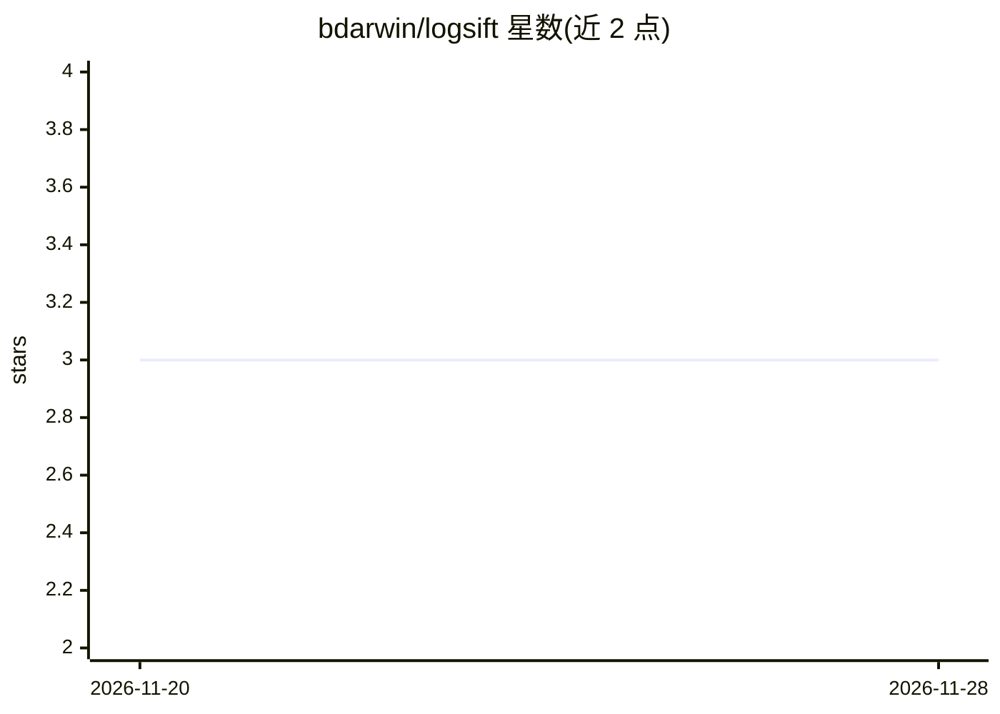

# bdarwin/logsift

⭐ 3 · Java · MIT · 推送 2026-11-26 · [GitHub](https://github.com/bdarwin/logsift) · [官网](https://bdarwin.github.io/logsift/) · 个人维护

**给开发者的大日志分析与 JVM 诊断桌面工具，可接 AI 助手问答**

Logsift 是一款跨平台（Windows/macOS/Linux）桌面日志分析工具：索引 GB 级日志、实时 tail、多条件过滤、请求跨文件追踪、异常按根因分组、SQL 查询日志、CSV 对比，并能解析线程转储、GC 日志、堆转储与崩溃转储，可通过 SSH/attach 连接运行中的 JVM 做性能剖析。AI 部分以可选功能提供：在应用内调用 GitHub Copilot 或 Claude Code 助手回答日志相关问题，或作为 MCP 服务器供外部编码 agent 读取本地日志，读取前需确认并对密钥脱敏。

## 筛选速览

| 维度 | 判定 | 备注 |
|---|---|---|
| AI 角色 | `ai-enhanced` | 去掉 AI 部分产品仍成立 |
| 许可风险 | `permissive` | MIT |
| 部署形态 | `desktop` | 安装包/桌面程序 |
| 模型依赖 | locked-api |  |
| 硬件要求 | — | 无带数字的原话,不猜 |
| 安装摩擦 | `medium` | 含编译或系统依赖之一 |
| 成熟度 | — | 结构信号不足 |

## 能力要点

- GB 级日志即时索引与实时 tail，支持 zip/.gz/文件夹并行搜索
- 解析线程转储、GC 日志、.hprof 堆转储与 Windows 崩溃转储并给出解释
- 内嵌 GitHub Copilot / Claude Code 助手，引用可点击行号并显示成本
- 作为 MCP 服务器供编码 agent 调用，只读且密钥脱敏

## 适用场景

- 排查线上服务大体积日志中的错误与请求链路
- 分析 JVM 线程转储、GC 日志和堆转储定位内存与停顿问题
- 让编码 agent 通过 MCP 读取本地日志回答故障问题

## 场景标签

 · 领域:开发者工具/日志与诊断

## 证据(README 行号)

> L8: **Find out what your app did, from its logs to its threads.** Logsift opens gigabytes of logs instantly, tails them 
> L10: **Ask AI about it.** GitHub Copilot or Claude Code answers in Logsift's window, reading your logs, thread dumps, GC
> L46: - **Ask from your coding agent.** GitHub Copilot, Claude Code and other agents that support MCP (or skills, where M

## 星数曲线

2026-11-20 3 → 2026-11-28 3（+0）

---
*卡片 v1 · prompt 1.4 · 生成 2026-11-22 · 置信度 high · 依据 README sha `93d983fdcd28` · [字段定义](../../DATASET.md)*
