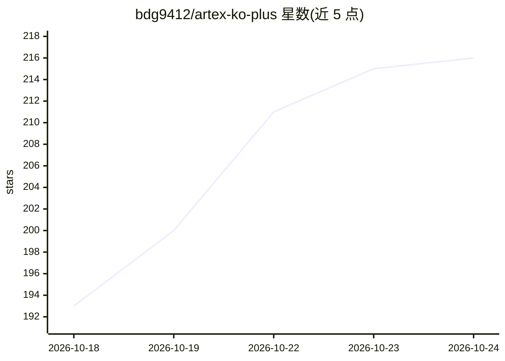

# bdg9412/artex-ko-plus

⭐ 231 · Go · AGPL-3.0 · 推送 2026-10-24 · [GitHub](https://github.com/bdg9412/artex-ko-plus) · 个人维护 · 中文 README

**ARTEX 韩语版扩展：漏洞诊断、事件调查与检测规则闭环的 Web 平台**

基于 ARTEX 韩语版（上游 Autumn-27/ARTEX，AGPL-3.0）扩展的攻防验证 Web 应用，保留 Go·Next.js·PostgreSQL 结构。新增：API/源码诊断（Schemathesis·Semgrep 收集候选并逐条 AI 判定）、无漏洞起点的日志事件 AI 调查（文件或 Splunk 日志为证据，只读 Planner/Worker 调查）、检测规则改进与重验证闭环及离线规则评估（TP/FP/precision/recall）。通过 ./scripts/local-start.sh 以 Docker Compose 构建运行；漏洞点检与 AI 调查需用户自行配置 LLM 连接；不自动部署运营 SIEM 规则或阻断策略。

## 筛选速览

| 维度 | 判定 | 备注 |
|---|---|---|
| AI 角色 | `ai-native` | 本体是模型或模型工具 |
| 许可风险 | `viral` | AGPL-3.0 |
| 部署形态 | `self-host` | docker 或自建部署 |
| 模型依赖 | — | README 未给出锁定关系 |
| 硬件要求 | — | 无带数字的原话,不猜 |
| 安装摩擦 | `low` | 无编译、无系统依赖或容器化 |
| 成熟度 | — | 结构信号不足 |

## 能力要点

- Offensive：OpenAPI/URL/HAR/源码 ZIP 输入，Schemathesis·Semgrep 候选收集与逐条 AI 判定续查
- Defensive：文件或 Splunk 日格证据起点的 AI 事件调查，只读范围限制
- Closed-loop：漏洞重验证→证据收集→候选规则保存→新验证 ID 重执行的检测改进闭环
- 离线日志规则评估：基线/候选规则对比，输出 TP/FP/TN/FN·precision·recall

## 适用场景

- 授权环境下做漏洞点检并验证是否被检测/阻断
- 用历史日志（文件或 Splunk）发起 AI 辅助的入侵事件调查
- 通过攻击重执行对比检测规则改进前后的检出与误报

## 场景标签

`网络安全` · 领域:学习与行业

## 证据(README 行号)

> L92: 로그 근거 준비와 기초 분석에는 LLM이 필요하지 않습니다. 취약점 점검·재검증과 **AI 조사**에는 사용자가 설정한 LLM 연결이 필요하며, AI 조사 시작 시 선택된 취약점 근거와 로그 발췌가 그 공급
> L80: |침해 조사|파일 또는 Splunk로 과거 로그 근거를 준비한 뒤 AI 조사를 명시적으로 시작|가설·로그 조회·원문 확인·후속 계획, 관측/추정/자료 부족, 조사 이력과 원문 내보내기|

## 星数曲线

2026-10-18 193 → 2026-10-24 216（+23）

---
*卡片 v1 · prompt 1.4 · 生成 2026-10-22 · 置信度 high · 依据 README sha `d075f2144dd7` · [字段定义](../../DATASET.md)*
