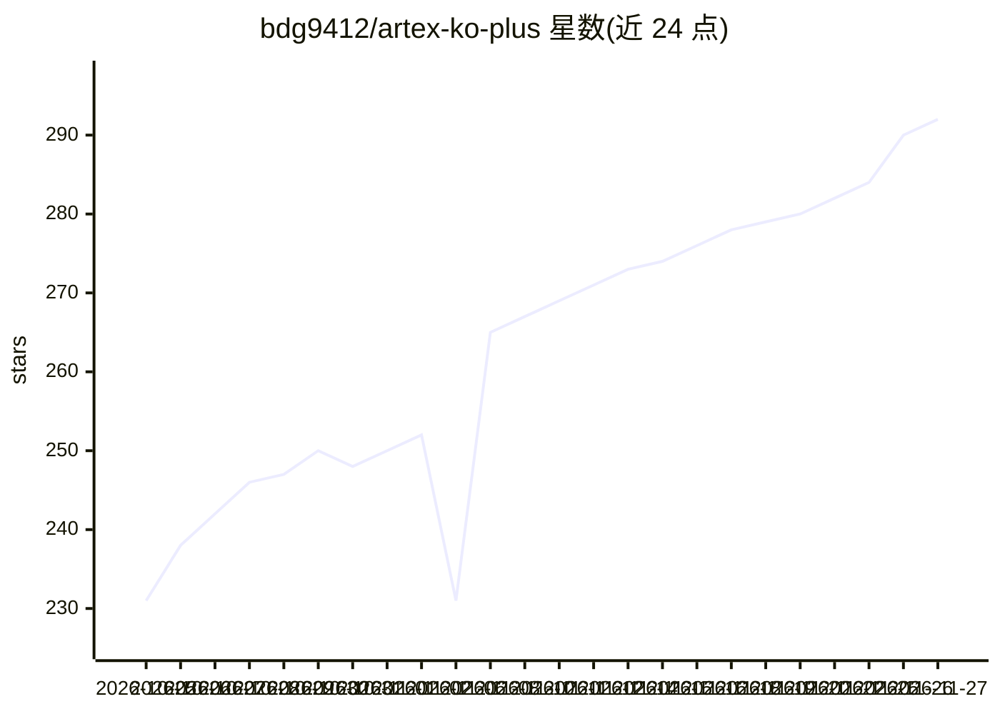

# bdg9412/artex-ko-plus

⭐ 292 · Go · AGPL-3.0 · 推送 2026-11-07 · [GitHub](https://github.com/bdg9412/artex-ko-plus) · 个人维护

**韩语版安全验证平台：漏洞诊断、防御验证与自主狩猎**

基于 ARTEX 韩语版 artex-ko 的安全验证项目 AegisLoop：以授权资产上发现的漏洞为起点，由 Planner·Worker 引擎执行渗透诊断并记录证据；再用漏洞证据生成攻击与检测场景草稿（含 SPL 初稿），结合文件或只读 Splunk 日志独立判定复现、检测与阻断；另提供四阶段（Research→Scenario→Hunting→Verification）的 Defensive 自主狩猎，并每 15 分钟采集 CISA KEV 与安全新闻动态。Docker Compose 运行，默认含应用与 PostgreSQL，Splunk 与演练靶场需另行准备。

## 筛选速览

| 维度 | 判定 | 备注 |
|---|---|---|
| AI 角色 | `ai-native` | 本体是模型或模型工具 |
| 许可风险 | `viral` | AGPL-3.0 |
| 部署形态 | `self-host` | docker 或自建部署 |
| 模型依赖 | local-ok | 支持本地模型 |
| 硬件要求 | — | 无带数字的原话,不猜 |
| 安装摩擦 | `low` | 无编译、无系统依赖或容器化 |
| 成熟度 | — | 结构信号不足 |

## 能力要点

- Planner·Worker 多智能体引擎在授权范围内执行漏洞诊断并保留资产/探索图
- 漏洞证据驱动的攻击·检测场景生成，含 SPL 检测规则草稿
- 四阶段自主狩猎：公开资料核验、假设设计、只读 Splunk 查询、证据判定
- 支持 Anthropic/OpenAI/Ollama/Amazon Bedrock/OrcaRouter 等多种 LLM 连接配置

## 适用场景

- 在授权测试后验证安全设备与检测规则能否发现和阻断该漏洞
- 用 Splunk 历史日志对 CVE 与攻击技术做蓝队自主狩猎
- 跟踪 CISA KEV 与安全新闻并为自有资产筛选狩猎目标
- 从漏洞复现到入侵调查的完整证据链复盘

## 场景标签

`多智能体` `网络安全` · 领域:Agent 开发

## 证据(README 行号)

> L9: AegisLoop는 ARTEX의 한국어판 artex-ko를 기반으로 한 보안 검증 프로젝트입니다. 허가된 자산에서 찾은 취약점을 출발점으로 공격·탐지 시나리오를 설계하고, 실제 실행 로그로 탐지·차단 여부를 
> L13: **시스템 → LLM → 새 프로필**에서 모델 연결을 직접 선택할 수 있습니다. 화면에서 제공하는 형식은 **Anthropic**, **OpenAI (Chat Completions)**, **OpenAI 
> L170: 취약점 상세의 방어 검증·침해 조사는 Splunk 없이 파일 업로드로 시작할 수 있습니다. **자율헌팅은 활성화된 Splunk 연결과 LLM 설정이 필요합니다.** Splunk 연결의 인덱스와 `sourc

## 星数曲线

2026-10-25 231 → 2026-11-27 292（+61）

---
*卡片 v1 · prompt 1.4 · 生成 2026-11-25 · 置信度 high · 依据 README sha `556cdaa82493` · [字段定义](../../DATASET.md)*
