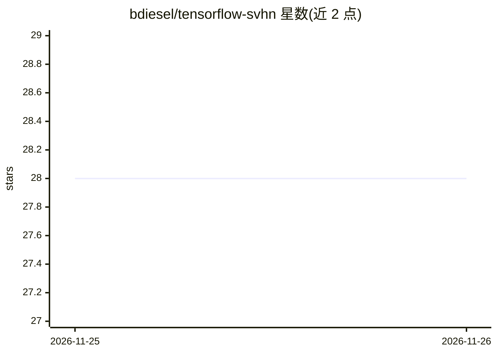

# bdiesel/tensorflow-svhn

⭐ 28 · Python · 推送 2026-11-23 · [GitHub](https://github.com/bdiesel/tensorflow-svhn) · 个人维护

**基于 SVHN 数据集识别真实照片中多位数字序列的 TensorFlow 模型**

2016 年 Udacity 机器学习纳米学位毕业项目，用 SVHN 数据集训练 CNN，读取真实世界照片中的多位数字序列（如门牌号）。流程为：下载数据 → 先训练单数字分类器，再复用其权重训练多位读取器，提供预训练权重；用 TensorBoard 查看训练曲线。代码基于 Python 2.7 与早期 TensorFlow 1.x API，按原样保留作参考，完整报告见 PDF。

## 筛选速览

| 维度 | 判定 | 备注 |
|---|---|---|
| AI 角色 | `ai-native` | 本体是模型或模型工具 |
| 许可风险 | `none` | — |
| 部署形态 | `None` |  |
| 模型依赖 | — | README 未给出锁定关系 |
| 硬件要求 | — | 无带数字的原话,不猜 |
| 安装摩擦 | `low` | 无编译、无系统依赖或容器化 |
| 成熟度 | `idea` | |

## 能力要点

- 单数字分类器与多位数字读取器两级训练流程
- 提供单数字与多位读取器的预训练权重
- TensorBoard 日志查看模型训练表现

## 适用场景

- 识别真实照片中的门牌号等数字序列
- 作为 CNN 训练流程的学习参考项目

## 场景标签

`模型训练` `目标检测` · 领域:感知与多模态

## 证据(README 行号)

> L3: A TensorFlow implementation of a
> L5: that reads multi-digit sequences, such as house numbers, from real-world photos. It is trained on the

## 星数曲线

2026-11-25 28 → 2026-11-26 28（+0）

---
*卡片 v1 · prompt 1.4 · 生成 2026-11-24 · 置信度 high · 依据 README sha `0d403c9330df` · [字段定义](../../DATASET.md)*
