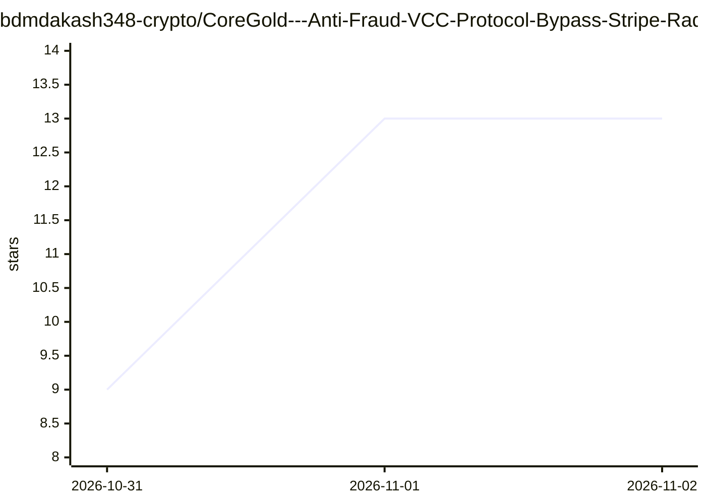

# bdmdakash348-crypto/CoreGold---Anti-Fraud-VCC-Protocol-Bypass-Stripe-Radars-Payment-Decline-on-OpenAI-Claude

⭐ 13 · 推送 2026-10-30 · [GitHub](https://github.com/bdmdakash348-crypto/CoreGold---Anti-Fraud-VCC-Protocol-Bypass-Stripe-Radars-Payment-Decline-on-OpenAI-Claude) · [官网](https://app.coregold.io/signup?invite_code=ADvlj9b) · 组织维护 · 中文 README

**推广 CoreGold 虚拟卡的营销文：讲解绕过 Stripe 风控支付 OpenAI/Claude**

该仓库不是软件项目，而是一篇面向 AI 订阅用户的推广文档：先以图表形式陈述 Stripe Radar 的风控流程（设备指纹、BIN 码信用库、AVS 地址校验、3D-Secure 预授权验资），再分步指导注册 CoreGold 控制台、充值 USDT、开通商用卡段虚拟卡并绑定 OpenAI/Claude 完成扣款。全文不含代码、安装命令或可运行产物，核心内容为第三方商业发卡服务的引流注册指引。

## 筛选速览

| 维度 | 判定 | 备注 |
|---|---|---|
| AI 角色 | `ai-knowledge` | 知识聚合/清单类 |
| 许可风险 | `none` | — |
| 部署形态 | `None` |  |
| 模型依赖 | — | README 未给出锁定关系 |
| 硬件要求 | — | 无带数字的原话,不猜 |
| 安装摩擦 | `low` | 无编译、无系统依赖或容器化 |
| 成熟度 | — | 结构信号不足 |

## 能力要点

- 以流程图陈述 Stripe Radar 四层风控机制（指纹/BIN/AVS/预授权）
- 提供 4 步开卡与绑卡操作指引（注册、USDT 充值、开卡、绑卡）
- 宣传 USDT 充值、单卡限额、注销退款等商业发卡服务功能

## 适用场景

- 了解 Stripe 支付风控的常见拦截环节
- 按文档指引注册并使用 CoreGold 虚拟卡服务

## 场景标签

 · 领域:支付/营销内容

## 证据(README 行号)

> L2: 为什么你的卡总在 OpenAI 被秒拒？Stripe 风控逆向与 CoreGold 硬核过风控指南
> L7: 👉 **立即注册 CoreGold（直连高权重开卡网关）**
> L111: 🚀 **点击注册并进入 CoreGold 发卡控制台**

## 星数曲线

2026-10-31 9 → 2026-11-02 13（+4）

---
*卡片 v1 · prompt 1.4 · 生成 2026-10-31 · 置信度 high · 依据 README sha `4d37d61ae1a3` · [字段定义](../../DATASET.md)*
