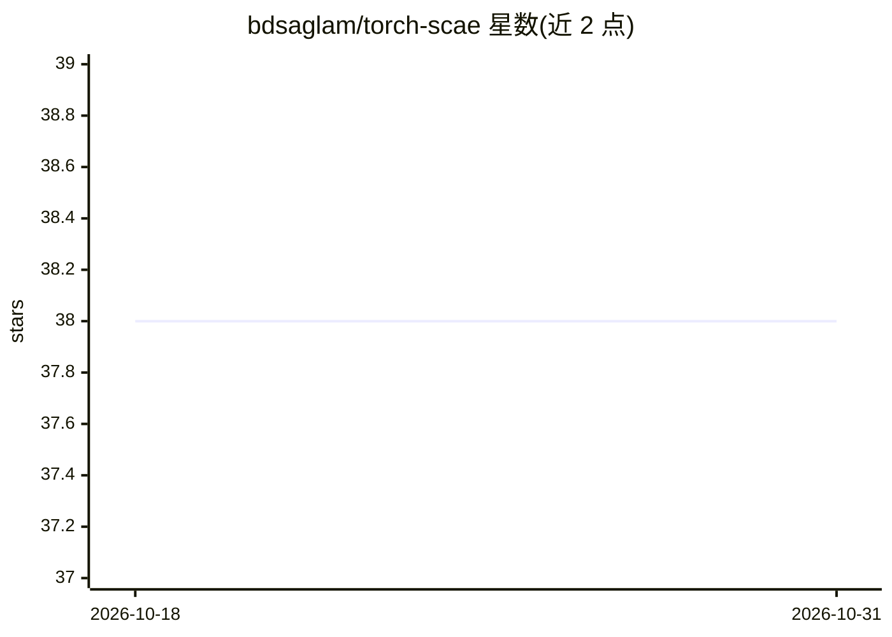

# bdsaglam/torch-scae

⭐ 38 · Python · Apache-2.0 · 推送 2026-09-23 · [GitHub](https://github.com/bdsaglam/torch-scae) · 个人维护

**Stacked Capsule Auto-Encoders 的 PyTorch 复现实现**

将 NeurIPS 2019 论文 Stacked Capsule Auto-Encoders 从 TensorFlow v1 官方实现移植到 PyTorch，保持模型结构与超参数一致并重构部分代码。训练基于 PyTorch Lightning，配置管理使用 Hydra，支持 CPU/GPU 训练 MNIST，可用线性探针与 k-means 聚类加二分图匹配评估 checkpoint。README 报告 40x40 MNIST 测试集无监督分类准确率与论文结果相当，A100 上训练约 4 小时。以 git clone 加 pip install -e 的源码方式提供，附 Colab 训练入口。

## 筛选速览

| 维度 | 判定 | 备注 |
|---|---|---|
| AI 角色 | `ai-native` | 本体是模型或模型工具 |
| 许可风险 | `permissive` | Apache-2.0 |
| 部署形态 | `library` | 以包/库形式分发 |
| 模型依赖 | — | README 未给出锁定关系 |
| 硬件要求 | — | 无带数字的原话,不猜 |
| 安装摩擦 | `low` | 无编译、无系统依赖或容器化 |
| 成熟度 | — | 结构信号不足 |

## 能力要点

- 从 TensorFlow v1 官方实现移植，结构与超参数保持一致
- PyTorch Lightning 训练 + Hydra 配置管理
- 按论文方式评估：线性探针与 k-means+二分图匹配
- 复现结果与论文报告值相当（98.6/98.9 vs 98.7/99.0）

## 适用场景

- 复现或研究 Stacked Capsule Auto-Encoders 架构
- 在 MNIST 上训练与评估胶囊自编码器
- 基于代码修改胶囊网络的结构或超参数

## 场景标签

 · 领域:深度学习/计算机视觉

## 证据(README 行号)

> L3: PyTorch implementation of Stacked Capsule Auto-Encoders \[1\].
> L5: Ported from official implementation with TensorFlow v1.

## 星数曲线

2026-10-18 38 → 2026-10-31 38（+0）

---
*卡片 v1 · prompt 1.4 · 生成 2026-10-25 · 置信度 high · 依据 README sha `4d8561285a10` · [字段定义](../../DATASET.md)*
