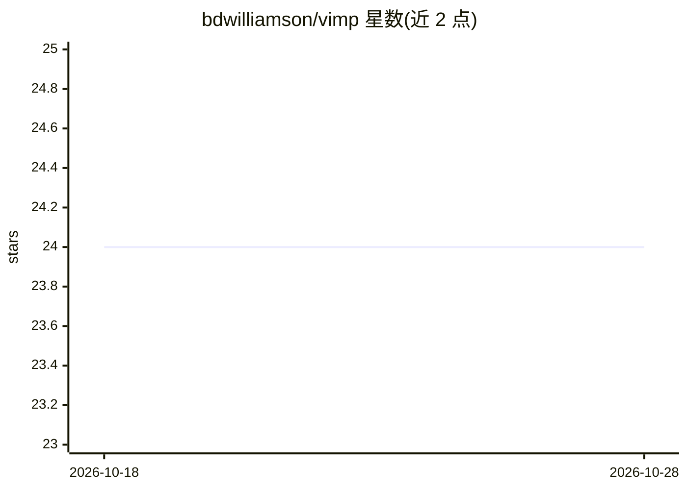

# bdwilliamson/vimp

⭐ 24 · R · NOASSERTION · 推送 2026-05-18 · [GitHub](https://github.com/bdwilliamson/vimp) · [官网](http://bdwilliamson.github.io/vimp/) · 个人维护

**R 包：对算法无关的变量重要性做统计推断**

面向统计建模与机器学习研究者的 R 包：给定任意预测算法的拟合值，计算总体层面的算法无关变量重要性估计，支持差分分类准确率、AUC、偏差、R² 四种重要性度量，并给出渐近有效置信区间与零重要性假设检验。适用于低维与高维数据，配套多篇方法学论文与 Python 版本 vimpy。可从 CRAN 或 GitHub 安装，MIT 许可，项目自述为活跃维护状态。

## 筛选速览

| 维度 | 判定 | 备注 |
|---|---|---|
| AI 角色 | `ai-native` | 本体是模型或模型工具 |
| 许可风险 | `permissive` | NOASSERTION |
| 部署形态 | `None` |  |
| 模型依赖 | — | README 未给出锁定关系 |
| 硬件要求 | — | 无带数字的原话,不猜 |
| 安装摩擦 | `low` | 无编译、无系统依赖或容器化 |
| 成熟度 | — | 结构信号不足 |

## 能力要点

- 基于任意预测算法拟合值计算总体变量重要性估计
- 提供渐近有效置信区间与零重要性假设检验
- 支持分类准确率/AUC/偏差/R² 四种重要性度量
- 配套 R²、一般化与 Shapley 三类方法学论文及 Python 版本 vimpy

## 适用场景

- 评估机器学习模型中特征子集对结局的相对贡献
- 在科研分析中检验某变量重要性是否为零
- 低维或高维数据下做非参数变量重要性推断

## 场景标签

 · 领域:统计/机器学习

## 证据(README 行号)

> L18: In predictive modeling applications, it is often of interest to determine the relative contribution of subsets of f
> L20: Specifically, the types of variable importance supported by `vimp` include: difference in population classification

## 星数曲线

2026-10-18 24 → 2026-10-28 24（+0）

---
*卡片 v1 · prompt 1.4 · 生成 2026-10-27 · 置信度 high · 依据 README sha `04388c727ae4` · [字段定义](../../DATASET.md)*
