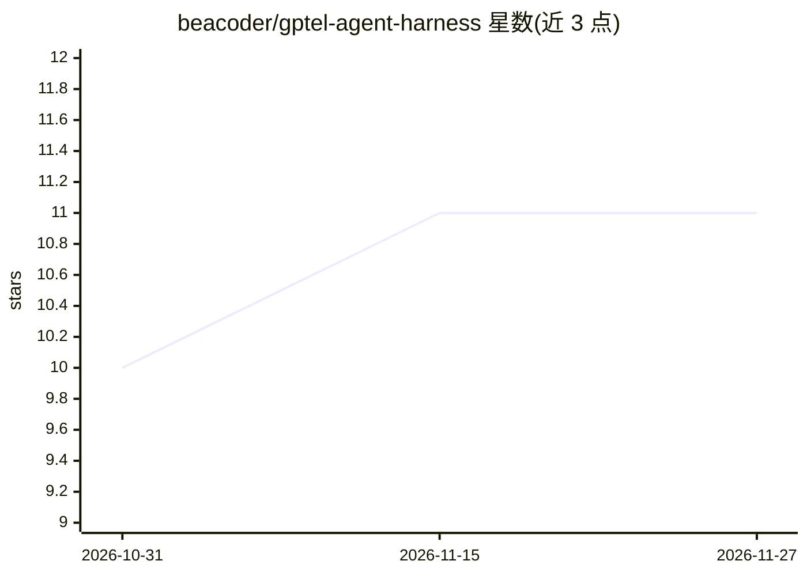

# beacoder/gptel-agent-harness

⭐ 11 · Emacs Lisp · GPL-3.0 · 推送 2026-11-25 · [GitHub](https://github.com/beacoder/gptel-agent-harness) · 个人维护

**为 Emacs gptel-agent 增加可靠自主编码代理行为的执行套件**

以 Emacs Lisp minor mode 实现的 gptel-agent 执行套件，在上游 gptel/gptel-agent 之上补充完成任务监督、上下文用量跟踪与自动压缩、会话自动保存与恢复、增强工具（Git 感知 Glob/Grep、带超时与输出截断的 Bash）以及 Plan/Build 两阶段模式；提供类 OpenCode 的自主编码代理会话入口、子代理模型配置、代码评审/摘要/项目初始化等命令，并对格式错误的工具调用做状态机恢复。需 Emacs ≥29.1 及 gptel-agent、compat 依赖。

## 筛选速览

| 维度 | 判定 | 备注 |
|---|---|---|
| AI 角色 | `ai-ecosystem` | LLM/agent 周边工具 |
| 许可风险 | `viral` | GPL-3.0 |
| 部署形态 | `None` |  |
| 模型依赖 | — | README 未给出锁定关系 |
| 硬件要求 | — | 无带数字的原话,不猜 |
| 安装摩擦 | `low` | 无编译、无系统依赖或容器化 |
| 成熟度 | — | 结构信号不足 |

## 能力要点

- 完成监督与上下文自动压缩（阈值可配置）
- 会话自动保存、标题生成与交互式恢复
- Plan 只读/Build 可写两阶段模式与 PlanExit 审批
- Bash 工具的静默/总超时与输出截断控制

## 适用场景

- 在 Emacs 中运行类 OpenCode 的自主编码代理
- 代理修改代码前先进入只读 Plan 模式生成计划
- 长会话中自动压缩上下文并恢复历史会话
- 用更便宜的子代理模型分担委托任务

## 场景标签

`编码 Agent` · 领域:编码与开发

## 证据(README 行号)

> L6: An execution harness for `gptel-agent` that adds reliable, autonomous coding-agent behavior.
> L8: It adds completion supervision, context management, session persistence, enhanced tools, Plan/Build modes, and OpenC
> L23: * **OpenCode agent** — Provides an OpenCode-like coding-agent experience through `gptel-opencode-agent`.

## 星数曲线

2026-10-31 10 → 2026-11-27 11（+1）

---
*卡片 v1 · prompt 1.4 · 生成 2026-11-18 · 置信度 high · 依据 README sha `89ebdd221b60` · [字段定义](../../DATASET.md)*
