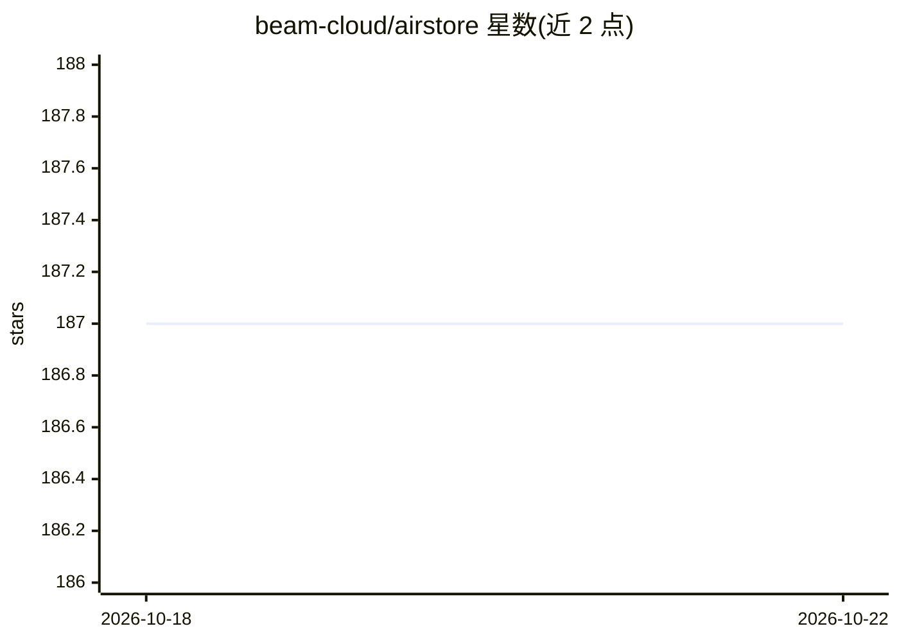

# beam-cloud/airstore

⭐ 187 · Go · AGPL-3.0 · 推送 2026-04-28 · [GitHub](https://github.com/beam-cloud/airstore) · [官网](https://www.airstore.ai/) · 组织维护

**把 Gmail/GitHub 等数据源挂载为虚拟文件系统供 AI agent 读取**

基于 FUSE 的虚拟文件系统：接入 GitHub、Gmail、Google Drive、Linear、Notion、Slack、Web 等集成，用自然语言或结构化过滤创建 source view，数据物化为本地文件供 Claude Code 等按文件方式读取；另将 MCP 服务器暴露为可执行工具命令，输出 JSON 可与 Unix 管道组合。提供云端账户模式与本地自托管模式；本地模式需 FUSE 与 Node.js，支持 macOS/Linux 从源码构建，Windows 尚未支持。

## 筛选速览

| 维度 | 判定 | 备注 |
|---|---|---|
| AI 角色 | `ai-ecosystem` | LLM/agent 周边工具 |
| 许可风险 | `viral` | AGPL-3.0 |
| 部署形态 | `None` |  |
| 模型依赖 | — | README 未给出锁定关系 |
| 硬件要求 | — | 无带数字的原话,不猜 |
| 安装摩擦 | `low` | 无编译、无系统依赖或容器化 |
| 成熟度 | — | 结构信号不足 |

## 能力要点

- 自然语言/结构化查询物化为文件目录的 source view
- GitHub/Gmail/Drive/Linear/Notion/Slack 等 7 类集成
- MCP 服务器暴露为可执行工具，输出 JSON 可管道组合
- 本地自托管模式与团队工作区共享

## 适用场景

- 让 Claude Code 直接读取我邮箱里的发票并汇总
- 通过视图限定 agent 只能访问特定范围的数据（如上周发票）
- 自托管运行，用自己的 MCP 服务器在本地基础设施上挂载数据

## 场景标签

 · 领域:AI agent 基础设施

## 证据(README 行号)

> L12: Airstore adds any source of data into a virtual filesystem. Connect Gmail, GitHub, Linear — then describe what you 
> L26: - **Tools** - MCP servers exposed as executable binaries

## 星数曲线

2026-10-18 187 → 2026-10-22 187（+0）

---
*卡片 v1 · prompt 1.4 · 生成 2026-10-22 · 置信度 high · 依据 README sha `8b6605976589` · [字段定义](../../DATASET.md)*
