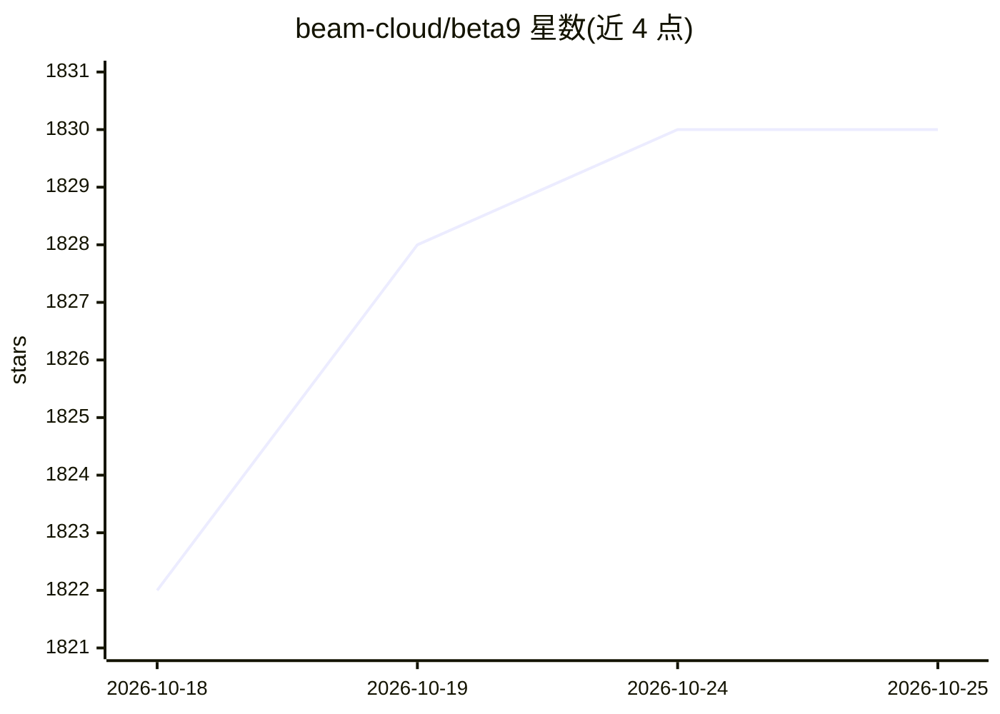

# beam-cloud/beta9

⭐ 1,830 · Go · AGPL-3.0 · 推送 2026-10-25 · [GitHub](https://github.com/beam-cloud/beta9) · [官网](https://beam.cloud) · 组织维护

**面向开发者的开源 serverless GPU 运行时：部署并弹性伸缩 AI 负载**

Beam 开源的开源运行时 beta9，为无服务器 AI 负载提供 Pythonic 接口：用装饰器和少量代码即可创建运行 LLM 生成代码的沙箱容器、部署带 QueueDepthAutoscaler 自动伸缩的自定义模型推理端点、调度后台任务（可替代 Celery 队列）。机制上使用自研容器运行时、调度器与内嵌缓存实现亚秒级冷启动，支持扇出到数百容器、scale-to-zero、分布式卷挂载。可在 Beam 托管云（4090/H100）或自带 GPU 上运行，支持免费自托管或选择托管云。客户端通过 pip 安装 beam-client。

## 筛选速览

| 维度 | 判定 | 备注 |
|---|---|---|
| AI 角色 | `ai-ecosystem` | LLM/agent 周边工具 |
| 许可风险 | `viral` | AGPL-3.0 |
| 部署形态 | `library` | 以包/库形式分发 |
| 模型依赖 | — | README 未给出锁定关系 |
| 硬件要求 | — | 无带数字的原话,不猜 |
| 安装摩擦 | `low` | 无编译、无系统依赖或容器化 |
| 成熟度 | — | 结构信号不足 |

## 能力要点

- 自研容器运行时+调度器+内嵌缓存，冷启动亚秒级
- 沙箱容器运行 LLM 生成代码
- 装饰器定义自动伸缩推理端点与后台任务
- scale-to-zero、分布式卷存储、数百容器并发扇出

## 适用场景

- 把自定义模型部署为自动伸缩的 serverless 推理端点
- 在隔离沙箱中执行 LLM 生成的代码
- 用声明式装饰器替换 Celery 跑弹性后台任务
- 无基础设施负担地扇出并行 GPU 工作负载

## 场景标签

`推理引擎` · 领域:训练与推理

## 证据(README 行号)

> L26: **Beam** is a fast, open-source runtime for serverless AI workloads. It gives you a Pythonic interface to deploy an
> L83: > Beta9 is the open-source engine powering Beam, our fully-managed cloud platform. You can self-host Beta9 for free

## 星数曲线

2026-10-18 1,822 → 2026-10-25 1,830（+8）

---
*卡片 v1 · prompt 1.4 · 生成 2026-10-21 · 置信度 high · 依据 README sha `3e40ecf6f7f1` · [字段定义](../../DATASET.md)*
