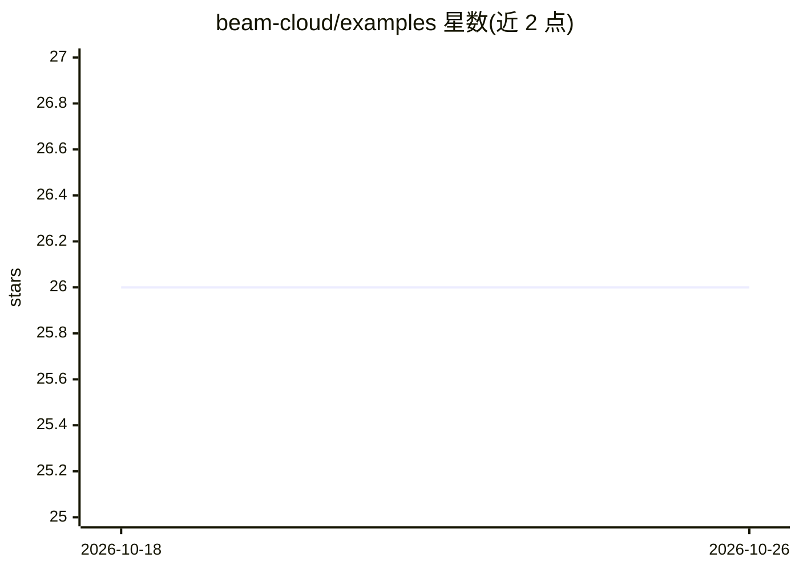

# beam-cloud/examples

⭐ 26 · Python · 推送 2026-10-21 · [GitHub](https://github.com/beam-cloud/examples) · [官网](https://docs.beam.cloud) · 组织维护

**Beam 云平台示例程序集合，供用户运行参考**

beam-cloud 维护的官方示例仓库，README 仅说明 examples 文件夹包含多个用 Beam 构建的程序示例，用户可自行运行，前提是拥有免费的 Beam 账号。README 未展开具体示例清单、类别或运行命令，属于平台配套文档型仓库。面向评估或上手 Beam 无服务器平台的开发者。

## 筛选速览

| 维度 | 判定 | 备注 |
|---|---|---|
| AI 角色 | `ai-ecosystem` | LLM/agent 周边工具 |
| 许可风险 | `none` | — |
| 部署形态 | `None` |  |
| 模型依赖 | — | README 未给出锁定关系 |
| 硬件要求 | — | 无带数字的原话,不猜 |
| 安装摩擦 | `low` | 无编译、无系统依赖或容器化 |
| 成熟度 | — | 结构信号不足 |

## 能力要点

- 包含多个基于 Beam 构建的示例程序
- 用户可在注册免费 Beam 账号后自行运行

## 适用场景

- 上手 Beam 平台时查找示例代码
- 了解 Beam 上程序的构建方式

## 场景标签

`教程课程` · 领域:学习与行业

## 证据(README 行号)

> L5: The `examples` folder in this repo contains various examples of programs built with Beam.
> L7: You can run any of these examples yourself. All you need is a free account on Beam.

## 星数曲线

2026-10-18 26 → 2026-10-26 26（+0）

---
*卡片 v1 · prompt 1.4 · 生成 2026-10-26 · 置信度 low · 依据 README sha `245a31240079` · [字段定义](../../DATASET.md)*
