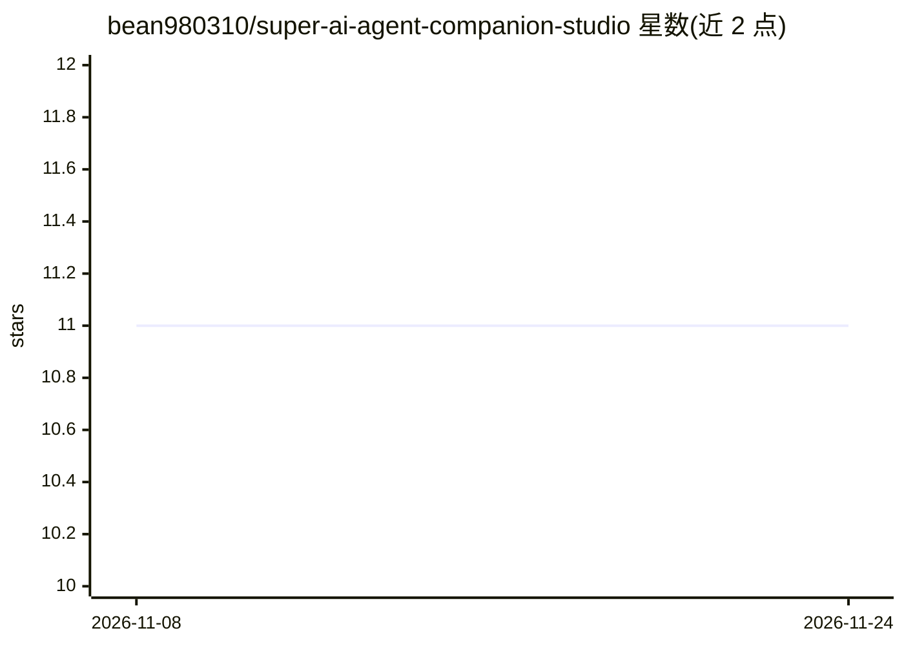

# bean980310/super-ai-agent-companion-studio

⭐ 11 · Python · Apache-2.0 · 推送 2026-11-21 · [GitHub](https://github.com/bean980310/super-ai-agent-companion-studio) · 个人维护

**本地运行的 AI 伴侣应用：聊天、生图、讲故事一体化**

基于 Gradio 的本地 AI 伴侣应用，提供聊天机器人、图像生成、故事生成与翻译功能。聊天支持 OpenAI/Anthropic/Google API 与本地 Transformers/GGUF/MLX 模型，提供用户与角色人格设定及超参数调节；图像生成经 ComfyUI 后端支持 Stable Diffusion 系列与 FLUX 模型，含 LoRA、VAE、图生图等选项；翻译支持从上传图片或 PDF 提取文本。通过脚本安装依赖，Windows 直接运行时无 GPU 加速，建议 WSL2；Intel Mac 已不再支持。

## 筛选速览

| 维度 | 判定 | 备注 |
|---|---|---|
| AI 角色 | `ai-native` | 本体是模型或模型工具 |
| 许可风险 | `permissive` | Apache-2.0 |
| 部署形态 | `library` | 以包/库形式分发 |
| 模型依赖 | locked-api |  |
| 硬件要求 | — | 无带数字的原话,不猜 |
| 安装摩擦 | `high` | 编译与系统依赖俱全 |
| 成熟度 | — | 结构信号不足 |

## 能力要点

- 聊天支持 API（OpenAI/Anthropic/Google）与本地 Transformers/GGUF/MLX 模型
- 图像生成经 ComfyUI 后端，支持 SD 1.5–3.5、FLUX 系列及 LoRA/VAE/Refiner
- 人格系统：系统提示词、角色与预设切换
- 翻译功能支持从上传图片或 PDF 提取文本

## 适用场景

- 在本地电脑搭建可与 AI 角色对话的伴侣应用
- 通过统一界面调用本地 Stable Diffusion/FLUX 模型生成图片
- 对上传的图片或 PDF 中的文本做多语言翻译

## 场景标签

`聊天机器人` `图像生成` `AI 写作` · 领域:对话与助手

## 证据(README 行号)

> L7: A Gradio-based AI companion app leveraging generative AI models (LLMs, Diffusion models, etc.) running in a local en
> L13: The AI Companion offers chatbot services along with AI-powered generation of images, videos, and audio content. Uti
> L66: Create images using models like Stable Diffusion and Flux. Images are generated via ComfyUI backend.

## 星数曲线

2026-11-08 11 → 2026-11-24 11（+0）

---
*卡片 v1 · prompt 1.4 · 生成 2026-11-18 · 置信度 mid · 依据 README sha `9aa84ab2e3de` · [字段定义](../../DATASET.md)*
