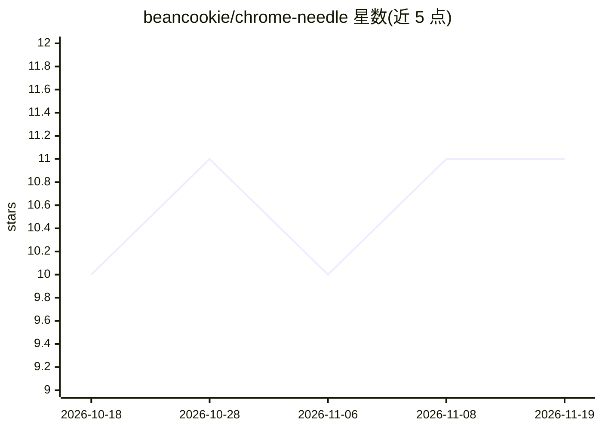

# beancookie/chrome-needle

⭐ 11 · JavaScript · 推送 2026-08-13 · [GitHub](https://github.com/beancookie/chrome-needle) · 个人维护 · 中文 README

**浏览器内完全离线运行的 45M 参数 LLM 浏览器代理扩展**

Chrome 扩展，内置 Needle 2（45M 参数 LLM），模型引擎与权重本地打包于 WASM 中，首次加载后无需网络。提供 18 个内置浏览器工具（页面读取、点击、表单填写、标签页管理、书签、截图、剪贴板、HTTP 请求、自定义脚本），每次工具调用附带置信度分数；支持通过可视化编辑器编写自定义 JS 工具，中文输入经 iciba API 自动翻译。用户在侧边栏以自然语言下达指令驱动浏览器操作。安装方式为下载 ZIP 后拖拽或加载解压目录。

## 筛选速览

| 维度 | 判定 | 备注 |
|---|---|---|
| AI 角色 | `ai-native` | 本体是模型或模型工具 |
| 许可风险 | `none` | — |
| 部署形态 | `desktop` | 安装包/桌面程序 |
| 模型依赖 | — | README 未给出锁定关系 |
| 硬件要求 | — | 无带数字的原话,不猜 |
| 安装摩擦 | `low` | 无编译、无系统依赖或容器化 |
| 成熟度 | — | 结构信号不足 |

## 能力要点

- 18 个内置浏览器工具，5 个以 Schema 暴露给模型
- 模型（13MB .cact）+ WASM 引擎（307KB）本地打包，运行内存约 28MB
- 每次工具调用附带置信度分数
- 可视化编辑器编写自定义 JS 工具函数

## 适用场景

- 自然语言指令完成网页导航、搜索与表单填写
- 多标签页批量操作（如打开并跳转新标签页）
- 用随机测试数据自动填写并提交表单
- 离线环境下运行浏览器自动化代理

## 场景标签

`浏览器自动化` · 领域:效率与自动化

## 证据(README 行号)

> L3: A Chrome browser extension powered by Needle 2 (45M parameter LLM), running entirely in local WASM.
> L7: - **18 built-in browser tools** — page reading, clicking, form filling, tab management, bookmarks, screenshots, noti
> L10: - **Fully offline** — model engine + weights bundled locally, no network needed after first load

## 星数曲线

2026-10-18 10 → 2026-11-19 11（+1）

---
*卡片 v1 · prompt 1.4 · 生成 2026-11-18 · 置信度 high · 依据 README sha `02ac7142cac1` · [字段定义](../../DATASET.md)*
