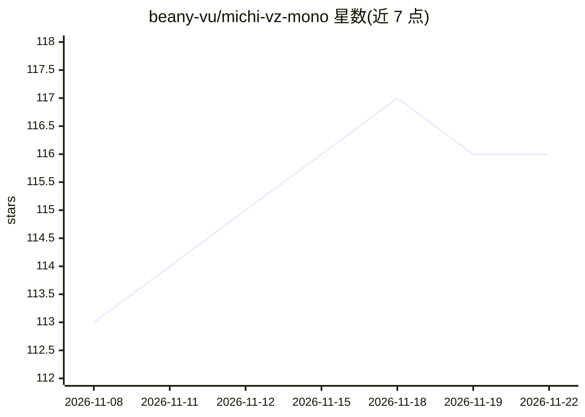

# beany-vu/michi-vz-mono

⭐ 116 · TypeScript · MIT · 推送 2026-10-06 · [GitHub](https://github.com/beany-vu/michi-vz-mono) · [官网](https://michi-vz.netlify.app/) · 个人维护

**跨框架 D3 图表库：React/Vue/Svelte/Angular/Web Components 通用渲染引擎**

框架无关的纯 TS 图表渲染引擎，22 种图表类型（含金融场景的龙卷风图、区间图、瀑布/桑基图等），通过薄封装层支持 React、Vue 3、Svelte、Angular、原生 Web Components 或无框架使用，提供 SVG、Canvas 及实验性 WebGPU 渲染器。每个图表输出结构化的 LLM-ready ChartContext（数据+统计+规则化自然语言摘要+a11y 表格镜像），另有可选的 AI insights 层（预测/异常/叙述/agent-MCP，进行中）与页面内 devtools 面板。全系列 npm 包发布，MIT 许可。

## 筛选速览

| 维度 | 判定 | 备注 |
|---|---|---|
| AI 角色 | `ai-enhanced` | 去掉 AI 部分产品仍成立 |
| 许可风险 | `permissive` | MIT |
| 部署形态 | `library` | 以包/库形式分发 |
| 模型依赖 | — | README 未给出锁定关系 |
| 硬件要求 | — | 无带数字的原话,不猜 |
| 安装摩擦 | `low` | 无编译、无系统依赖或容器化 |
| 成熟度 | `idea` | |

## 能力要点

- 同一引擎支持 React/Vue/Svelte/Angular/Web Components/原生 JS
- 22 种图表类型，SVG/Canvas/实验性 WebGPU 三种渲染器
- 每个图表输出 LLM-ready 的 ChartContext 结构化数据上下文
- 提供 llms.txt 机器可读文档与页面内 devtools 面板

## 适用场景

- 在多个框架的技术栈间保持统一的图表标准
- 构建可交互的金融/分析仪表盘（预测与实际值对照）
- 为 AI 功能或报告生成结构化的图表数据上下文

## 场景标签

 · 领域:前端/数据可视化

## 证据(README 行号)

> L4: twenty-two chart types, and first-class support for **React, Vue, Svelte, Angular,
> L42: Angular**, and an opt-in client-side **AI insights** layer (`@michi-vz/insights`,
> L43: in progress). Every chart emits a renderer-agnostic, LLM-ready **`ChartContext`**

## 星数曲线

2026-11-08 113 → 2026-11-22 116（+3）

---
*卡片 v1 · prompt 1.4 · 生成 2026-11-17 · 置信度 high · 依据 README sha `8503842d7d8e` · [字段定义](../../DATASET.md)*
