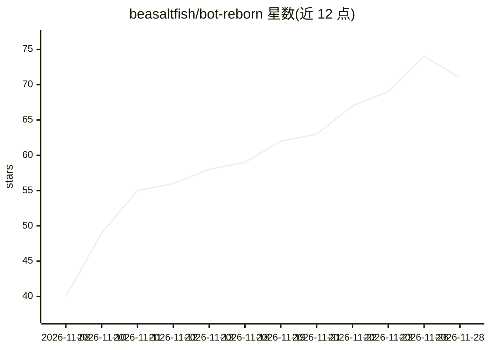

# beasaltfish/bot-reborn

⭐ 71 · JavaScript · MIT · 推送 2026-11-23 · [GitHub](https://github.com/beasaltfish/bot-reborn) · [官网](https://bot-reborn.agentlenshq.com) · 个人维护 · 中文 README

**把 AI 玩具机器人从想法做到硬件的工作台**

面向 DIY 创客的工作台：用浏览器内的接线模拟器练习 ESP32 接线，再通过 Chrome/Edge 管理页一键烧录固件、配置 Wi-Fi 与角色；机器人的“大脑”是运行在用户自己电脑上的 Node 服务器，通过任一 OpenAI 兼容供应商接入语音转文字、对话与语音合成，另可选 0.8B 本地反射模型在约 200ms 内响应简单指令。支持 ESP32-S3 和旧手机两种机身，手机机身经 FT232H 与 WebUSB 驱动玩具车。当前 ESP32 机身尚不能开车，部分硬件数据未测量。

## 筛选速览

| 维度 | 判定 | 备注 |
|---|---|---|
| AI 角色 | `ai-ecosystem` | LLM/agent 周边工具 |
| 许可风险 | `permissive` | MIT |
| 部署形态 | `library` | 以包/库形式分发 |
| 模型依赖 | — | README 未给出锁定关系 |
| 硬件要求 | — | 无带数字的原话,不猜 |
| 安装摩擦 | `low` | 无编译、无系统依赖或容器化 |
| 成熟度 | — | 结构信号不足 |

## 能力要点

- 浏览器内 ESP32 接线模拟器，错误烧毁的是虚拟元件
- 管理页经 USB 烧录固件并配置角色，无需 ESP-IDF
- 0.8B 反射模型本地运行，约 200ms 响应简单驾驶指令
- 任一 OpenAI 兼容供应商均可接入，密钥只保存在本地电脑

## 适用场景

- 把廉价玩具车改造成能语音对话和驾驶的 AI 机器人
- 买硬件前先在浏览器里练接线、跑大脑
- 为不同角色配置不同供应商与语音，多机共用一个大脑

## 场景标签

`语音 Agent` · 领域:对话与助手

## 证据(README 行号)

> L7: > **A workbench that takes your AI gadget from idea to hardware.** Simulate it,
> L8: > wire it, flash it and configure it, with the AI brain running on your own
> L84: OpenAI-compatible provider works; the admin page has presets for common ones.

## 星数曲线

2026-11-08 40 → 2026-11-28 71（+31）

---
*卡片 v1 · prompt 1.4 · 生成 2026-11-18 · 置信度 high · 依据 README sha `1bc5b562f973` · [字段定义](../../DATASET.md)*
