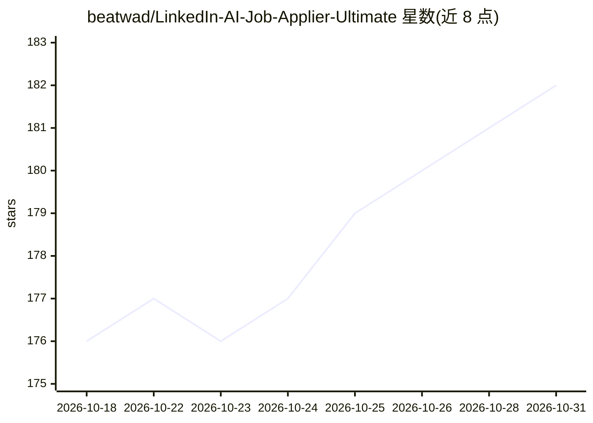

# beatwad/LinkedIn-AI-Job-Applier-Ultimate

⭐ 182 · Python · MIT · 推送 2026-10-23 · [GitHub](https://github.com/beatwad/LinkedIn-AI-Job-Applier-Ultimate) · 个人维护

**求职者自动化投递机器人：AI 定制简历并自动申请 LinkedIn/Indeed 职位**

AIHawk 项目的活跃 fork，用 Python 编写。基于 Patchright（Playwright 补丁版）浏览器自动化，在 LinkedIn（含非 Easy Apply 职位）与 Indeed 上自动投递申请；用 LLM（Gemini/OpenAI/Claude/Ollama）解析简历、按职位生成定制简历与回答申请问题，发送前对个人数据做匿名化替换；另提供技能需求统计、本地监控面板、LinkedIn 消息分类、自动拓联与 Telegram 报告。限制：站点 UI 变更可能随时导致功能失效，Indeed 上验证码与外链职位问题多，官方建议优先用 LinkedIn。

## 筛选速览

| 维度 | 判定 | 备注 |
|---|---|---|
| AI 角色 | `ai-native` | 本体是模型或模型工具 |
| 许可风险 | `permissive` | MIT |
| 部署形态 | `self-host` | docker 或自建部署 |
| 模型依赖 | — | README 未给出锁定关系 |
| 硬件要求 | — | 无带数字的原话,不猜 |
| 安装摩擦 | `low` | 无编译、无系统依赖或容器化 |
| 成熟度 | — | 结构信号不足 |

## 能力要点

- 覆盖 LinkedIn 全部职位类型（含非 Easy Apply）的自动投递
- LLM 解析简历并按职位描述生成定制简历与回答
- 发送 LLM 前对个人数据做匿名化替换
- 技能需求统计、本地监控面板与 Telegram 运行报告

## 适用场景

- 我想让机器人自动投递 LinkedIn 职位并生成针对性简历
- 我想统计目标职位的雇主高频技能需求
- 我想通过 Telegram 收到每次投递运行的报告

## 场景标签

`浏览器自动化` `AI 写作` · 领域:效率与自动化

## 证据(README 行号)

> L10: 🤖 AI-powered bot that **auto-applies** to jobs on **LinkedIn** and **Indeed**. It parses your resume, generates tai
> L66: * **🤖 AI-Powered Resume Parsing:** Automatically parses your resume from a text file into a structured format using
> L55: * **🎯 Improved Intelligent Resume Generation:** Uses AI to tailor every generated resume to the current vacancy for

## 星数曲线

2026-10-18 176 → 2026-10-31 182（+6）

---
*卡片 v1 · prompt 1.4 · 生成 2026-10-22 · 置信度 high · 依据 README sha `331a033c4a2f` · [字段定义](../../DATASET.md)*
