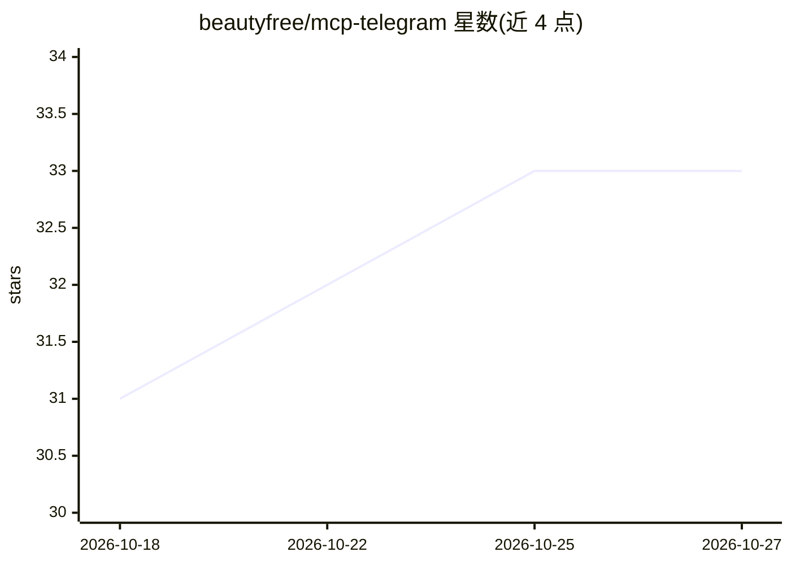

# beautyfree/mcp-telegram

⭐ 33 · TypeScript · MIT · 推送 2026-05-18 · [GitHub](https://github.com/beautyfree/mcp-telegram) · [官网](https://npmjs.com/mcp-telegram) · 个人维护

**把 Telegram 真人账号接入 MCP 客户端的工具服务器**

基于 MTProto 的 Telegram MCP 服务器：将 Claude Desktop、Cursor、Claude Code、VS Code、Codex、Cline、Windsurf 等 MCP 客户端连接到真实 Telegram 用户账号（非 bot），通过浏览器本地登录。提供 102 个工具覆盖对话读取/全局搜索、发消息、频道管理（封禁/提权/邀请链接/慢速模式）、故事/联系人/文件夹/隐私管理与语音转写，另可调用任意原始 MTProto 方法。限制：需 Node.js ≥20 与 my.telegram.org 的 api_id/api_hash；会话存于 ~/.telegram-agent/，README 提示需妥善保管；全部工具 schema 约占 12,700 token 上下文。

## 筛选速览

| 维度 | 判定 | 备注 |
|---|---|---|
| AI 角色 | `ai-ecosystem` | LLM/agent 周边工具 |
| 许可风险 | `permissive` | MIT |
| 部署形态 | `library` | 以包/库形式分发 |
| 模型依赖 | — | README 未给出锁定关系 |
| 硬件要求 | — | 无带数字的原话,不猜 |
| 安装摩擦 | `low` | 无编译、无系统依赖或容器化 |
| 成熟度 | — | 结构信号不足 |

## 能力要点

- 102 个工具覆盖消息读写、频道管理、故事、联系人、隐私等账号操作面
- invoke_mtproto 可按名称调用任意原始 MTProto 方法
- 浏览器本地登录，会话存于本地目录，支持多账号
- MCP_TELEGRAM_READONLY / MCP_TELEGRAM_TOOLS 环境变量控制工具暴露范围

## 适用场景

- 让 Claude/Cursor 等编程代理直接读写我的 Telegram 消息
- 用自然语言做频道管理与群组治理（封禁、邀请链接、论坛话题）
- 自动化发送/转发/回复 Telegram 消息与媒体

## 场景标签

`语音识别` · 领域:感知与多模态

## 证据(README 行号)

> L11: A Model Context Protocol (MCP) server that connects Claude Desktop, Codex CLI, Cursor, Claude Code, VS Code, Cline,
> L13: **Use it to:** read dialogs and search messages globally · send/edit/forward/react/poll · download media and transc

## 星数曲线

2026-10-18 31 → 2026-10-27 33（+2）

---
*卡片 v1 · prompt 1.4 · 生成 2026-10-26 · 置信度 high · 依据 README sha `0051db75a392` · [字段定义](../../DATASET.md)*
