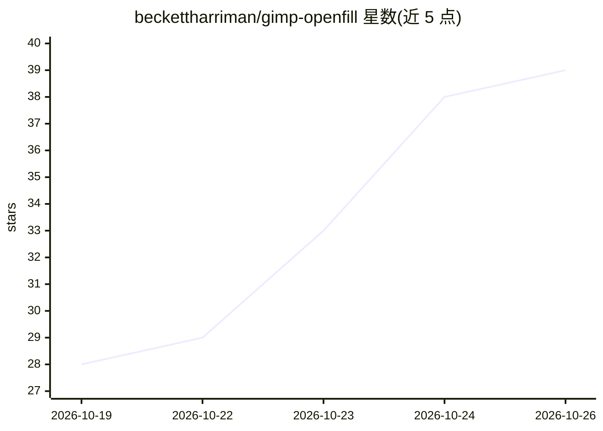

# beckettharriman/gimp-openfill

⭐ — · [GitHub]() · 个人维护

**GIMP 3 的本地生成式填充/扩图/物体移除插件**

面向 GIMP 3.2 用户的 Python 插件，提供提示词填充、物体移除（LaMa/MAT）、生成式扩图与文生图四类 AI 图像编辑功能，结果落在新建图层、单步可撤销。生成由本机 ComfyUI 后端完成，监听 127.0.0.1，由隐藏的 supervisor 随 GIMP 启停；不内置模型，首次运行经下载管理器从 Hugging Face/Civitai 获取（含 SHA-256 校验），并按显存与磁盘空间过滤推荐列表。测试平台为 Windows（8GB 笔记本 GPU）、Linux Flatpak 与 Apple M3；无 NVIDIA 卡时 SD 1.5 走 CPU（分钟级），AMD 未测试。自述为 Beta 早期版本。

## 筛选速览

| 维度 | 判定 | 备注 |
|---|---|---|
| AI 角色 | `ai-native` | 本体是模型或模型工具 |
| 许可风险 | `viral` | — |
| 部署形态 | `desktop` | 安装包/桌面程序 |
| 模型依赖 | — | README 未给出锁定关系 |
| 硬件要求 | — | 无带数字的原话,不猜 |
| 安装摩擦 | `medium` | 含编译或系统依赖之一 |
| 成熟度 | `idea` | |

## 能力要点

- 填充/移除/扩图/文生图四项功能均在 GIMP 内完成，结果在新图层
- ComfyUI 后端本地运行（127.0.0.1），空闲超时或 GIMP 关闭后自动停止
- 模型下载做 SHA-256 校验，推荐列表按显存与磁盘空间过滤
- 可复用已有的 ComfyUI 安装与已有 SD1.5/SDXL/FLUX 检查点（仅读 safetensors/gguf 头）

## 适用场景

- 在 GIMP 内直接对选区做提示词生成填充
- 套索选中后一键移除物体并补全背景
- 拖拽画布边缘做生成式扩图（可选比例与九宫格布局）

## 场景标签

`图像生成` `图像视频处理` · 领域:内容生成

## 证据(README 行号)

> L5: *Generative fill, expand and object removal for GIMP 3, running on your graphics card. You own the whole pipeline, n
> L21: |**Fill with a prompt**|Select, type "a red door with brass handles", Enter. The fill lands on a new layer with a m
> L23: |**Generative Expand**|Drag the canvas edges outward or pick a ratio, and it paints the new border. The prompt is o

## 星数曲线

2026-10-19 28 → 2026-10-26 39（+11）

---
*卡片 v1 · prompt 1.4 · 生成 2026-10-25 · 置信度 mid · 依据 README sha `e0edf9298641` · [字段定义](../../DATASET.md)*
