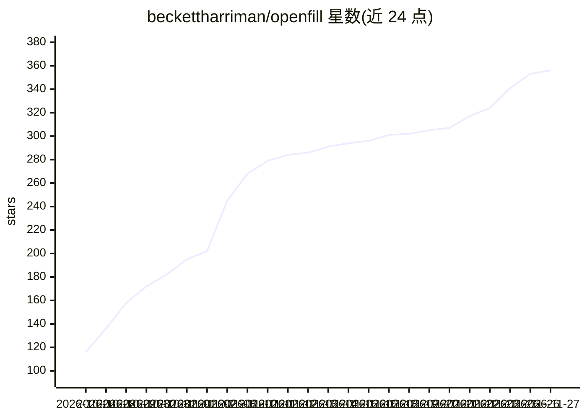

# beckettharriman/openfill

⭐ 356 · Python · Apache-2.0 · 推送 2026-11-26 · [GitHub](https://github.com/beckettharriman/openfill) · [官网](https://github.com/beckettharriman/openfill/releases) · 个人维护

**为 GIMP 3 与 PhotoCraft 提供本地生成式填充/扩图/去物的插件**

以插件形式为 GIMP 3、PhotoCraft（及 Patchy 原型伴侣模式）提供五类图像操作：提示词填充、去背景（BiRefNet）、去物（LaMa）、生成式扩图、文生图与 2x/4x 放大（Real-ESRGAN/SeedVR2）。后端为 ComfyUI，在 127.0.0.1 本地运行并随编辑器启停，结果写入新图层、单步撤销。提供 Releases 安装包与安装脚本，模型管理器按显存与磁盘推荐模型；另有可选的 OpenRouter/OpenAI 兼容/Gemini 云端后端与 Remote GPU 模式。

## 筛选速览

| 维度 | 判定 | 备注 |
|---|---|---|
| AI 角色 | `ai-enhanced` | 去掉 AI 部分产品仍成立 |
| 许可风险 | `permissive` | Apache-2.0 |
| 部署形态 | `desktop` | 安装包/桌面程序 |
| 模型依赖 | — | README 未给出锁定关系 |
| 硬件要求 | — | 无带数字的原话,不猜 |
| 安装摩擦 | `low` | 无编译、无系统依赖或容器化 |
| 成熟度 | `idea` | |

## 能力要点

- 五类操作：提示词填充、去背景（BiRefNet）、去物（LaMa）、扩图、文生图与放大
- 本地 ComfyUI 后端，仅监听 127.0.0.1，含 SHA-256 校验、无账户无遥测
- 模型管理器按显存/磁盘推荐模型，可识别本机 SD 1.5/SDXL/FLUX.1 Fill 文件
- Remote GPU 经 Tailscale 或 SSH 连接另一台机器的 ComfyUI

## 适用场景

- 在 GIMP 3 里选中区域后用提示词填充或移除物体
- 本机 GPU 上扩图和文生图而不用订阅云端服务
- 笔记本编辑、台式机跑 GPU 的远程生成工作流

## 场景标签

`图像生成` `图像视频处理` · 领域:内容生成

## 证据(README 行号)

> L5: *Generative fill, expand and object removal for PhotoCraft and GIMP 3, running on your graphics card. Local generati
> L15: I moved to GIMP 3 as my Photoshop replacement after paying Adobe an outrageously expensive cancellation fee. GIMP t
> L30: Generation runs in ComfyUI on your machine, listening on `127.0.0.1` only. The network comes into it only when you 

## 星数曲线

2026-10-26 116 → 2026-11-27 356（+240）

---
*卡片 v1 · prompt 1.4 · 生成 2026-11-27 · 置信度 high · 依据 README sha `19954d0b827e` · [字段定义](../../DATASET.md)*
