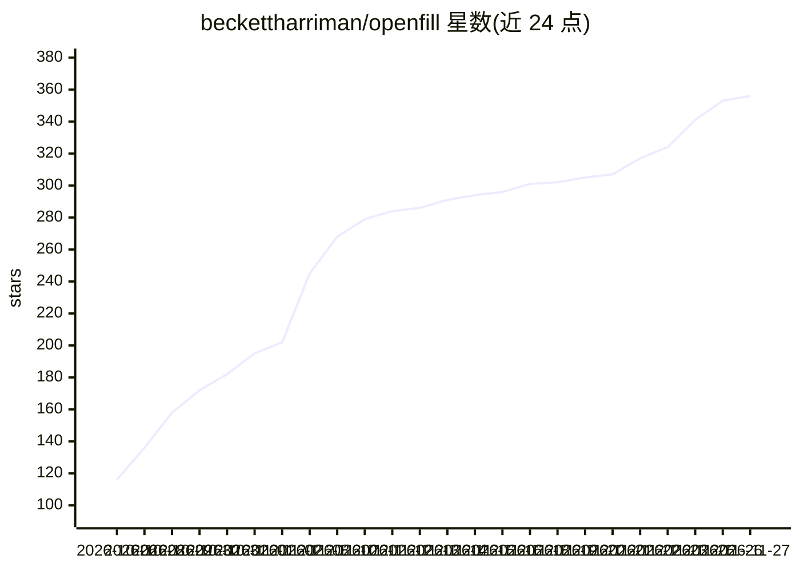

# beckettharriman/openfill

⭐ 356 · Python · Apache-2.0 · 推送 2026-11-26 · [GitHub](https://github.com/beckettharriman/openfill) · [官网](https://github.com/beckettharriman/openfill/releases) · 个人维护

**为 GIMP 3/PhotoCraft 提供本地 GPU 生成填充与扩图**

以 GIMP 3 插件与 PhotoCraft 面板形式提供的图像编辑工具，功能包括提示词填充选择区、擦除选中物体、画布外扩、文生图、背景去除（BiRefNet）与放大（Real-ESRGAN/SeedVR2）。生成后端为本机 ComfyUI，仅监听 127.0.0.1，模型经内置模型管理器按显存推荐下载并做 SHA-256 校验；结果落在新图层，一次撤销。需 NVIDIA 或 AMD RX 7000+ 显卡（推荐 8 GB），亦可通过 OpenRouter/Gemini API 走可选云端路径。Beta 阶段，FLUX 类填充约在 1024 px 工作后放大。

## 筛选速览

| 维度 | 判定 | 备注 |
|---|---|---|
| AI 角色 | `ai-enhanced` | 去掉 AI 部分产品仍成立 |
| 许可风险 | `permissive` | Apache-2.0 |
| 部署形态 | `desktop` | 安装包/桌面程序 |
| 模型依赖 | — | README 未给出锁定关系 |
| 硬件要求 | — | 无带数字的原话,不猜 |
| 安装摩擦 | `low` | 无编译、无系统依赖或容器化 |
| 成熟度 | `idea` | |

## 能力要点

- 生成填充/物体移除/画布扩展/文生图四类操作嵌入编辑器内
- 生成全程本机 ComfyUI 运行，仅监听 127.0.0.1，无遥测
- 内置模型管理器按显存与磁盘推荐模型，支持 .safetensors/.gguf
- 支持远程 GPU（经 Tailscale/SSH）与可选云 API 路径

## 适用场景

- 在 GIMP 3 里用提示词填充选区或扩展画布
- 本地 GPU 上移除照片中的物体且图像不外传
- 没有合适显卡时经云 API 或远程游戏 PC 完成生成

## 场景标签

`图像生成` `图像视频处理` · 领域:内容生成

## 证据(README 行号)

> L5: *Generative fill, expand and object removal for PhotoCraft and GIMP 3, running on your graphics card. Local generati
> L30: Generation runs in ComfyUI on your machine, listening on `127.0.0.1` only. The network comes into it only when you 

## 星数曲线

2026-10-26 116 → 2026-11-27 356（+240）

---
*卡片 v1 · prompt 1.4 · 生成 2026-11-25 · 置信度 high · 依据 README sha `5dc6fd9d7194` · [字段定义](../../DATASET.md)*
