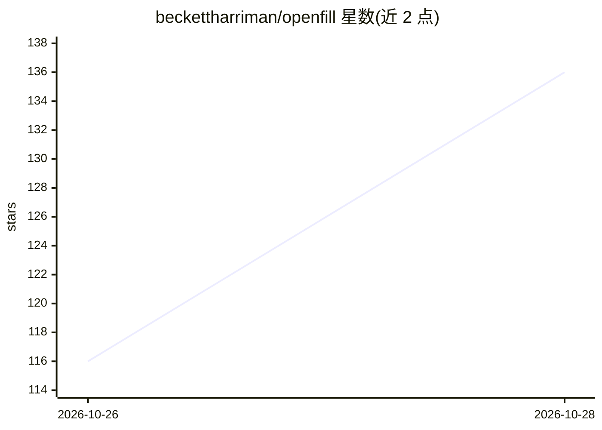

# beckettharriman/openfill

⭐ 158 · Python · Apache-2.0 · 推送 2026-10-26 · [GitHub](https://github.com/beckettharriman/openfill) · [官网](https://github.com/beckettharriman/openfill/releases) · 个人维护

**给 GIMP 3/PhotoCraft 用户的本地生成式填充/消除/扩图插件**

面向 GIMP 3.2 与 PhotoCraft 0.12–0.16 的图像编辑插件，通过本机 ComfyUI 后端提供四种操作：提示词填充选区、无提示消除物体、生成式扩边、从提示词新建图像/图层；结果落在新建图层、单步可撤销。生成仅监听 127.0.0.1，文件下载校验 SHA-256，无账号与遥测。不内置模型，模型管理器推荐 LaMa、DreamShaper 8 Inpainting 等并可发现已有的 SD 1.5/SDXL/FLUX.1 Fill 模型文件。自述处于 Beta，FLUX/Qwen 填充约在 1024 px 后放大，8 GB 显存上 FLUX 较慢。

## 筛选速览

| 维度 | 判定 | 备注 |
|---|---|---|
| AI 角色 | `ai-native` | 本体是模型或模型工具 |
| 许可风险 | `permissive` | Apache-2.0 |
| 部署形态 | `desktop` | 安装包/桌面程序 |
| 模型依赖 | — | README 未给出锁定关系 |
| 硬件要求 | — | 无带数字的原话,不猜 |
| 安装摩擦 | `low` | 无编译、无系统依赖或容器化 |
| 成熟度 | `idea` | |

## 能力要点

- 填充/消除/扩图/文生图四种操作，结果落在新图层且单步撤销
- 生成通过本机 ComfyUI（仅监听 127.0.0.1），不外发数据
- 模型管理器按显存推荐模型，并发现已有 .safetensors/.gguf 模型
- 支持 NVIDIA、AMD RX 7000+ 与 Apple Silicon，Windows 可自动下载 ComfyUI

## 适用场景

- 在 GIMP/PhotoCraft 里本地完成物体消除与提示词填充
- 不想用云端订阅服务、希望在自有 GPU 上扩图
- 从 Photoshop 迁移的用户继续使用生成式填充工作流

## 场景标签

`图像生成` · 领域:内容生成

## 证据(README 行号)

> L5: *Generative fill, expand and object removal for PhotoCraft and GIMP 3, running on your graphics card. Local generati
> L19:  Fill with a prompt Select, type "a red door with brass handles", Enter. The fill lands on a new layer with a soft 

## 星数曲线

2026-10-26 116 → 2026-10-28 136（+20）

---
*卡片 v1 · prompt 1.4 · 生成 2026-10-27 · 置信度 high · 依据 README sha `45126e24006e` · [字段定义](../../DATASET.md)*
