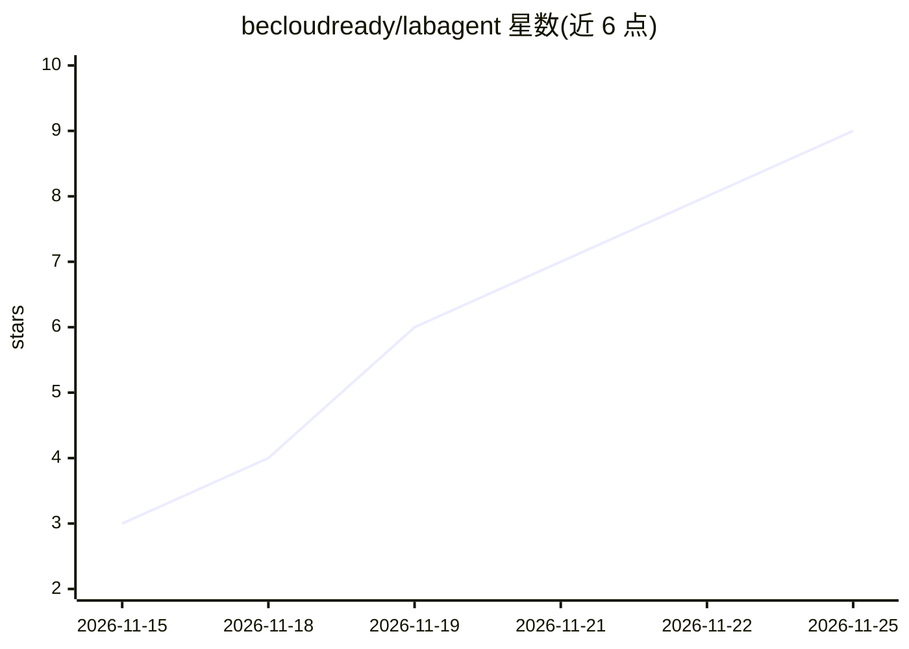

# becloudready/labagent

⭐ 9 · Python · Apache-2.0 · 推送 2026-11-23 · [GitHub](https://github.com/becloudready/labagent) · [官网](https://becloudready.com/labs) · 组织维护

**为培训/黑客松一键创建和销毁云与 AI 动手实验环境的 CLI**

以 pack（有序可重跑步骤）为单位管理实验环境：一条命令 launch 创建、失败后续跑、destroy 只清理本 pack 创建的资源。面向给他人跑实验的教练、训练营、高校课程与云厂商，覆盖 GPU 租用（Shadeform 切片+JupyterLab）、Databricks 湖仓/工作区（Terraform）、text-to-SQL 应用部署、RAG 实验室等预置 pack，也支持用单个 YAML 批量启动每个学员的沙箱并按小时计费后销毁。Apache-2.0，Mac/Linux/Windows 均可安装；另有厂商付费托管服务。

## 筛选速览

| 维度 | 判定 | 备注 |
|---|---|---|
| AI 角色 | `ai-enhanced` | 去掉 AI 部分产品仍成立 |
| 许可风险 | `permissive` | Apache-2.0 |
| 部署形态 | `library` | 以包/库形式分发 |
| 模型依赖 | — | README 未给出锁定关系 |
| 硬件要求 | — | 无带数字的原话,不猜 |
| 安装摩擦 | `low` | 无编译、无系统依赖或容器化 |
| 成熟度 | `idea` | |

## 能力要点

- pack 化的实验定义：launch 可从失败点续跑，destroy 只移除自身创建的资源
- gpu-notebooks pack：按学员拆分 GPU 切片，各自带独立 JupyterLab URL 与登录
- 单 YAML 文件批量管理全场活动的学员沙箱，只为使用小时付费
- azure-labs pack 支持快照迁移/归档旧资源组，含 row filter 等练习内容

## 适用场景

- 每个 cohort 为 5-50 名学员重复搭建相同的动手实验环境
- 在 GPU/云厂商自己的算力上办 workshop 和黑客松
- Azure Lab Services 退役前迁移或快照归档既有实验资源
- 不开采购实验平台的情况下给课程配 GPU/Databricks/AWS 虚拟实验室

## 场景标签

 · 领域:开发运维/培训基础设施

## 证据(README 行号)

> L1: # labagent: open-source hands-on Cloud & AI labs for technical training, workshops and hackathons
> L10: labagent builds a lab with one command and removes it with one more. Each lab is a **pack**: ordered, re-runnable s
> L47: |`gpu-notebooks`|Rent a GPU VM (Shadeform) and give each GPU slice its own JupyterLab, with a URL and login per lab

## 星数曲线

2026-11-15 3 → 2026-11-25 9（+6）

---
*卡片 v1 · prompt 1.4 · 生成 2026-11-20 · 置信度 mid · 依据 README sha `3e735c45feeb` · [字段定义](../../DATASET.md)*
