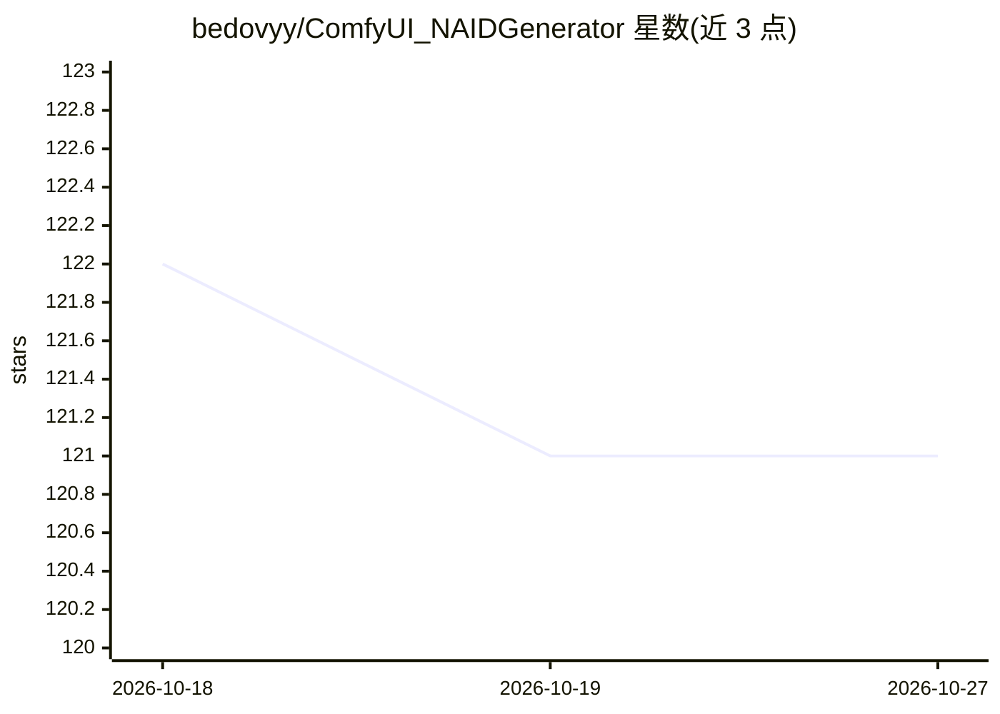

# bedovyy/ComfyUI_NAIDGenerator

⭐ 121 · Python · GPL-3.0 · 推送 2026-08-21 · [GitHub](https://github.com/bedovyy/ComfyUI_NAIDGenerator) · 个人维护

**ComfyUI 扩展：通过 NovelAI API 节点生成图像**

面向 ComfyUI 用户的自定义节点集，通过 NovelAI API 调用 nai-diffusion 系列 V4/V4.5/V5 模型进行文生图、图生图、局部重绘、Vibe Transfer 风格迁移与角色参考。使用前需在 ComfyUI 目录的 .env 中配置 NAI_ACCESS_TOKEN，生成的图像会自动保存以保留原始元数据。附带 Anlas 用量追踪节点、ComfyUI 提示词语法转换节点（PromptToNAID），以及 LineArt/Emotion/RemoveBG 等 director 工具节点。支持多角色文本提示与 V4 系提示词节点。

## 筛选速览

| 维度 | 判定 | 备注 |
|---|---|---|
| AI 角色 | `ai-native` | 本体是模型或模型工具 |
| 许可风险 | `viral` | GPL-3.0 |
| 部署形态 | `None` |  |
| 模型依赖 | — | README 未给出锁定关系 |
| 硬件要求 | — | 无带数字的原话,不猜 |
| 安装摩擦 | `low` | 无编译、无系统依赖或容器化 |
| 成熟度 | — | 结构信号不足 |

## 能力要点

- 文生图/图生图/局部重绘/Vibe Transfer/角色参考节点
- 支持 nai-diffusion V4/V4.5/V5 模型与多角色提示
- Anlas 余额与消耗追踪（控制台输出 + 可视化节点）
- PromptToNAID 节点转换 ComfyUI 与 NovelAI 提示词语法

## 适用场景

- 在 ComfyUI 工作流中直接调用 NovelAI 模型出图
- 用参考图做风格迁移或角色一致性生成
- 追踪 NovelAI 订阅内 Anlas 点数的消耗情况

## 场景标签

`图像生成` · 领域:内容生成

## 证据(README 行号)

> L3: A ComfyUI extension for generating images via the NovelAI API.
> L29: ### Txt2img

## 星数曲线

2026-10-18 122 → 2026-10-27 121（-1）

---
*卡片 v1 · prompt 1.4 · 生成 2026-10-23 · 置信度 high · 依据 README sha `6dcfa9c5c633` · [字段定义](../../DATASET.md)*
