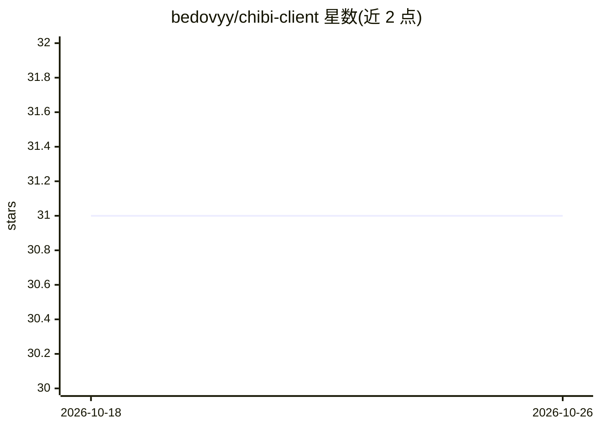

# bedovyy/chibi-client

⭐ 31 · Vue · MIT · 推送 2026-03-02 · [GitHub](https://github.com/bedovyy/chibi-client) · [官网](https://bedovyy.github.io/chibi-client) · 个人维护

**Vue3 编写的 txt2img 前端客户端，连接 ComfyUI 与 SD WebUI**

基于 Vue3 开发的文生图 Web 客户端，通过访问 ComfyUI 或 Stable Diffusion web UI 的接口进行 txt2img 生成。提供三种使用方式：作为 ComfyUI 扩展 git clone 到 custom_nodes 目录、作为 SD Web UI 扩展从 URL 安装（需以 --api 选项运行）、或克隆仓库后以 npm run dev / 任意 Web 服务器独立运行。功能包括简单 txt2img 生成、移动端响应式页面、danbooru 标签自动补全、PWA 支持，并提供在线 Demo 页面。

## 筛选速览

| 维度 | 判定 | 备注 |
|---|---|---|
| AI 角色 | `ai-ecosystem` | LLM/agent 周边工具 |
| 许可风险 | `permissive` | MIT |
| 部署形态 | `None` |  |
| 模型依赖 | — | README 未给出锁定关系 |
| 硬件要求 | — | 无带数字的原话,不猜 |
| 安装摩擦 | `low` | 无编译、无系统依赖或容器化 |
| 成熟度 | — | 结构信号不足 |

## 能力要点

- 支持 ComfyUI、Stable Diffusion web UI 两种后端及独立运行
- 移动端响应式页面与 PWA 支持
- danbooru 标签自动补全
- 提供 GitHub Pages 在线 Demo

## 适用场景

- 在手机浏览器上使用 ComfyUI 生成图片
- 为 ComfyUI/SD Web UI 换一个轻量简单的 txt2img 界面
- 通过 PWA 安装为应用随时访问生成功能

## 场景标签

`图像生成` · 领域:内容生成

## 证据(README 行号)

> L3: A Simple txt2img client for ComfyUI and Stable Diffusion web UI, developed in Vue3.
> L10: - `git clone https://github.com/bedovyy/chibi-client` into the `custom_nodes` directory.

## 星数曲线

2026-10-18 31 → 2026-10-26 31（+0）

---
*卡片 v1 · prompt 1.4 · 生成 2026-10-26 · 置信度 high · 依据 README sha `622956f79287` · [字段定义](../../DATASET.md)*
