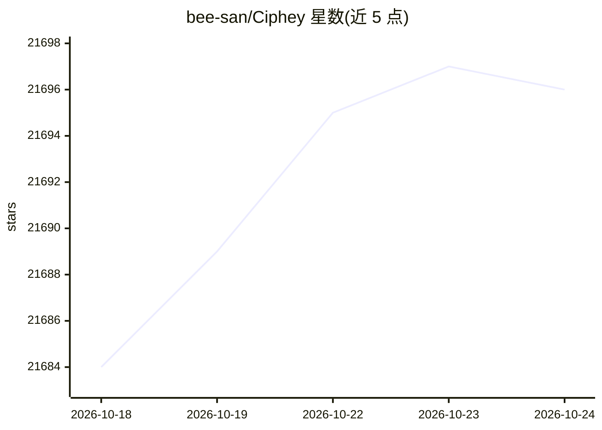

# bee-san/Ciphey

⭐ 21,696 · Rust · MIT · 推送 2026-10-13 · [GitHub](https://github.com/bee-san/Ciphey) · 个人维护

**无需密钥自动解密/解码文本的 Rust CLI 工具**

终端工具：粘贴被编码或加密的文本，无需密钥或密码名，自动搜索解码器链条并输出明文；支持 24 种解码器（Base64/Base32/Hex/Morse/Caesar/Vigenère 等），默认 5 秒超时，支持 regex crib 与词表匹配判定明文，LemmeKnow 识别 120+ 格式。Rust 编写，A* 搜索、Rayon 并行与 sqlite 缓存。可作 crate 库使用，另提供 MCP server 供 AI 助手调用；crates.io 发布版与 master 分支 API 存在差异。

## 筛选速览

| 维度 | 判定 | 备注 |
|---|---|---|
| AI 角色 | `ai-enhanced` | 去掉 AI 部分产品仍成立 |
| 许可风险 | `permissive` | MIT |
| 部署形态 | `desktop` | 安装包/桌面程序 |
| 模型依赖 | — | README 未给出锁定关系 |
| 硬件要求 | — | 无带数字的原话,不猜 |
| 安装摩擦 | `medium` | 含编译或系统依赖之一 |
| 成熟度 | — | 结构信号不足 |

## 动量与使用信号

- 维护:`active` — 距上次 push 5.0 天,年发版 1,50 位贡献者
- 涨星:近 1 天 **+3**(自 20261016 起算)
- 下载:GitHub Release 附件 累计 1,067(30 个 release)
- 平台:WINDOWS / MACOS / LINUX · 协议:MCP

## 能力要点

- 24 种解码器，支持多层嵌套链条自动搜索（A* 优先尝试最有希望链条）
- LemmeKnow 识别 120+ 格式（IP、token、CTF flag 等）
- regex crib 与词表模式限定明文判定
- 提供 ciphey-mcp MCP server，含 decode/decode_with/detect_plaintext/list_decoders 四个工具

## 适用场景

- CTF 中遇到未知编码/加密的字符串时自动还原明文
- 脚本中用 -d 无交互模式批量解码
- 让 Claude Desktop / Kiro 等 AI 助手通过 MCP 调用解码能力

## 场景标签

`网络安全` · 领域:学习与行业

## 证据(README 行号)

> L92: Ciphey doesn't need to be told what it's looking at. It searches chains of decoders (Base64 inside hex inside ROT13
> L197: `ciphey-mcp` is a Model Context Protocol server, so AI assistants such as Claude Desktop and Kiro can decode text 

## 星数曲线

2026-10-18 21,684 → 2026-10-24 21,696（+12）

---
*卡片 v1 · prompt 1.4 · 生成 2026-10-18 · 置信度 mid · 依据 README sha `becf0bcb61d5` · [字段定义](../../DATASET.md)*
