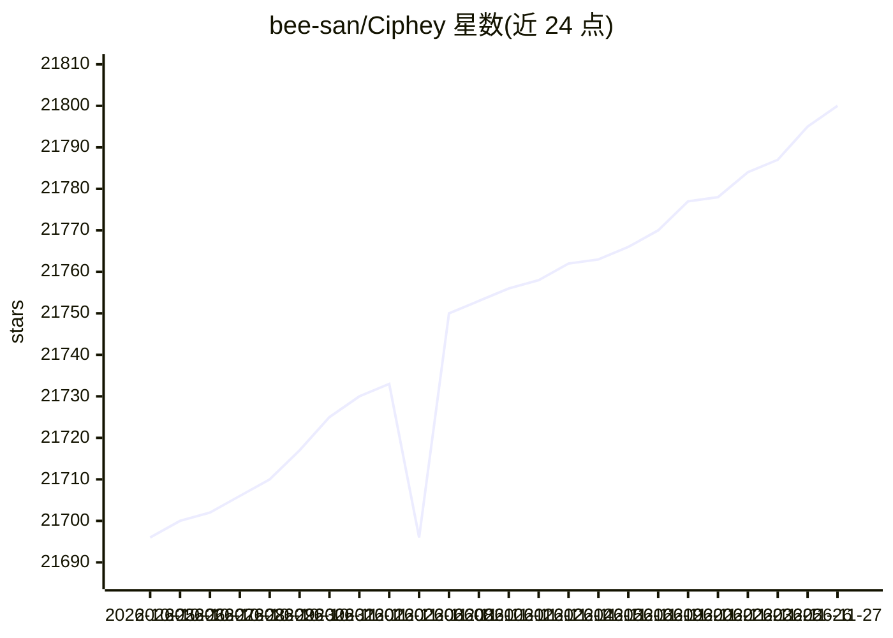

# bee-san/Ciphey

⭐ 21,800 · Rust · MIT · 推送 2026-11-06 · [GitHub](https://github.com/bee-san/Ciphey) · 个人维护

**自动解密/解编码/破解哈希的终端工具，无需密钥**

用 Rust 编写的命令行与库工具：输入未知编码或加密的文本，自动搜索解码器链并输出明文。内置 24 个解码器（Base 系、hex、Morse、Caesar/ROT13、Vigenère 等），用 A* 搜索与 Rayon 并行尝试多层嵌套解码，结果缓存于本地 SQLite。候选明文经 LemmeKnow（pyWhat 的 Rust 移植）识别 120 余种格式，支持 regex crib、wordlist 匹配与超时控制。提供 Discord bot、Rust crate 库接口，以及面向 AI 助手的 ciphey-mcp 服务器（四个工具，feature 开关控制）。

## 筛选速览

| 维度 | 判定 | 备注 |
|---|---|---|
| AI 角色 | `ai-enhanced` | 去掉 AI 部分产品仍成立 |
| 许可风险 | `permissive` | MIT |
| 部署形态 | `desktop` | 安装包/桌面程序 |
| 模型依赖 | — | README 未给出锁定关系 |
| 硬件要求 | — | 无带数字的原话,不猜 |
| 安装摩擦 | `medium` | 含编译或系统依赖之一 |
| 成熟度 | — | 结构信号不足 |

## 动量与使用信号

- 维护:`active` — 距上次 push 5.0 天,年发版 1,50 位贡献者
- 涨星:近 1 天 **+3**(自 20261016 起算)
- 下载:GitHub Release 附件 累计 1,067(30 个 release)
- 平台:WINDOWS / MACOS / LINUX · 协议:MCP

## 能力要点

- 24 个解码器，自动搜索多层嵌套解码链，无需密钥或密码名
- LemmeKnow 识别 120+ 格式（IP、token、CTF flag 等）并标注发现内容
- regex crib 与 wordlist 模式限定可接受的明文
- 提供 MCP 服务器（decode/decode_with/detect_plaintext/list_decoders 四工具）供 AI 助手调用

## 适用场景

- CTF 比赛中快速解出未知编码/加密的字符串
- 分析不明来源文本的编码方式与内容类型
- 在脚本中批量自动解码（-d 免确认模式）
- 让 Claude Desktop 等助手通过 MCP 调用解码能力

## 场景标签

`网络安全` · 领域:学习与行业

## 证据(README 行号)

> L5:  Paste in text that's been encoded or encrypted. Ciphey works out how and hands you the plaintext.
> L197: `ciphey-mcp` is a Model Context Protocol server, so AI assistants such as Claude Desktop and Kiro can decode text 
> L137: The `ciphey` binary is a thin wrapper around the `ciphey` crate. The Discord bot uses it as well, and so can your 

## 星数曲线

2026-10-25 21,696 → 2026-11-27 21,800（+104）

---
*卡片 v1 · prompt 1.4 · 生成 2026-11-22 · 置信度 low · 依据 README sha `eef9d9ea5543` · [字段定义](../../DATASET.md)*
