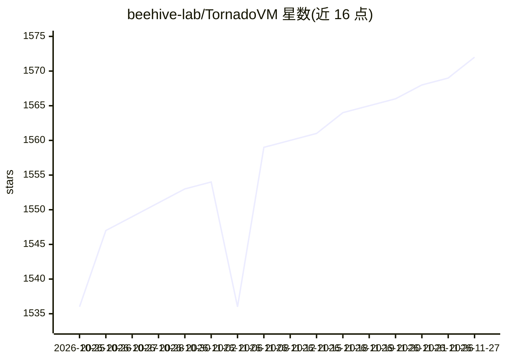

# beehive-lab/TornadoVM

⭐ 1,572 · Java · Apache-2.0 · 推送 2026-11-25 · [GitHub](https://github.com/beehive-lab/TornadoVM) · [官网](https://www.tornadovm.org) · 组织维护

**把 Java 程序 JIT 编译到 GPU 上运行的编程框架**

TornadoVM 是面向 Java 的 GPU 编程框架，支持 JDK 21–27，运行时把 Java 字节码 JIT 编译为 CUDA、HIP、OpenCL C 或 Metal (MSL)，使同一份代码可跑在 NVIDIA、AMD、Intel、Apple Silicon GPU 及多核 CPU 上。提供三种编程 API（@Parallel、KernelContext、TileContext），在 NVIDIA 硬件上可原生调用 cuBLAS/cuFFT/cuDNN/cuDF 库任务并暴露 Tensor Core 指令，支持 CUDA Graphs 与 Leyden AOT/GraalVM native image 加速启动。前置条件为 JDK 21+、GCC≥13 及对应驱动/工具包，通过 SDKMAN 或 Maven Central 安装。

## 筛选速览

| 维度 | 判定 | 备注 |
|---|---|---|
| AI 角色 | `ai-ecosystem` | LLM/agent 周边工具 |
| 许可风险 | `permissive` | Apache-2.0 |
| 部署形态 | `None` |  |
| 模型依赖 | — | README 未给出锁定关系 |
| 硬件要求 | — | 无带数字的原话,不猜 |
| 安装摩擦 | `high` | 编译与系统依赖俱全 |
| 成熟度 | — | 结构信号不足 |

## 能力要点

- 运行时将 Java 字节码 JIT 编译为 CUDA/HIP/OpenCL/Metal 内核
- 三种编程模型：@Parallel、KernelContext、TileContext（cuTile，仅 CUDA）
- NVIDIA 生态原生集成：cuBLAS、cuFFT、cuDNN、cuDF 库任务与 mma.sync Tensor Core 指令
- 通过 java.lang.foreign 绑定原生库，Maven Central 提供 per-JDK 构件

## 适用场景

- 让现有 Java 计算密集代码在 GPU 或多核 CPU 上运行
- 在纯 Java 中做 LLM 推理（如 jitllm 配合 LangChain4j）
- 加速计算机视觉、物理仿真、信号处理等 Java 工作负载
- 在 Apple Silicon 上用 Java 调用 Metal GPU

## 场景标签

`推理引擎` · 领域:训练与推理

## 证据(README 行号)

> L5: TornadoVM is a GPU programming framework for Java that works with JDK 21+ (currently JDK 21-27). It JIT-compiles Jav
> L119: |🦙 **jitllm**|LLM inference (Llama 3, Qwen 3, Mistral, Phi-3, Granite, DeepSeek distills) in pure Java — **117 tok
> L124: TornadoVM is used to accelerate machine learning and deep learning, computer vision, physics simulations, financia

## 星数曲线

2026-10-25 1,536 → 2026-11-27 1,572（+36）

---
*卡片 v1 · prompt 1.4 · 生成 2026-11-26 · 置信度 high · 依据 README sha `dc1712dc9078` · [字段定义](../../DATASET.md)*
