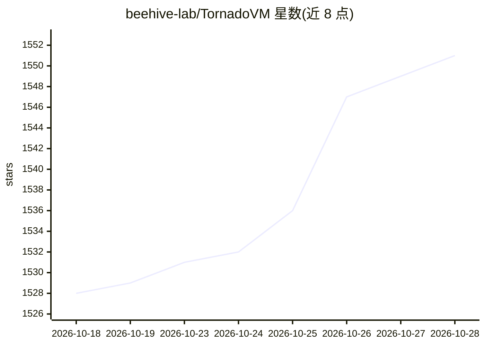

# beehive-lab/TornadoVM

⭐ 1,551 · Java · Apache-2.0 · 推送 2026-10-28 · [GitHub](https://github.com/beehive-lab/TornadoVM) · [官网](https://www.tornadovm.org) · 组织维护

**Java GPU 编程框架：把 Java 字节码 JIT 编译到 GPU 运行**

面向 Java 开发者的 GPU 加速框架，在运行时将 Java 字节码 JIT 编译为 NVIDIA CUDA（PTX/NVRTC）、OpenCL C 与 Apple Metal（MSL），支持 NVIDIA/AMD/Intel/Apple Silicon GPU 与多核 CPU。提供三种 API（@Parallel 注解、KernelContext 显式线程索引、TileContext tile 编程），并可将 cuBLAS/cuFFT/cuDNN/cuDF 库调用、Tensor Core mma.sync 内联函数与 JIT 内核合入同一 TaskGraph 和 CUDA Graph。作为 OpenJDK/GraalVM 的插件运行，不替换 JVM。需要 JDK 21+ 与对应后端驱动。

## 筛选速览

| 维度 | 判定 | 备注 |
|---|---|---|
| AI 角色 | `ai-ecosystem` | LLM/agent 周边工具 |
| 许可风险 | `permissive` | Apache-2.0 |
| 部署形态 | `None` |  |
| 模型依赖 | — | README 未给出锁定关系 |
| 硬件要求 | — | 无带数字的原话,不猜 |
| 安装摩擦 | `high` | 编译与系统依赖俱全 |
| 成熟度 | — | 结构信号不足 |

## 能力要点

- Java 字节码 JIT 编译为 CUDA PTX、OpenCL C 与 Apple Metal MSL
- 三种编程 API：@Parallel / KernelContext / TileContext（CUDA Tile）
- 从 Java 调用 cuBLAS/cuFFT/cuDNN/cuDF 库任务与 Tensor Core mma.sync 内联函数
- 以插件形式接入现有 OpenJDK/GraalVM，管理设备内存与内核编排

## 适用场景

- 把现有 Java 计算密集代码卸载到 GPU 加速
- 在纯 Java 中混合自写内核与 NVIDIA 优化库构建流水线
- 跨 NVIDIA/AMD/Intel/Apple 硬件运行同一份内核代码

## 场景标签

 · 领域:GPU 计算/编程框架

## 证据(README 行号)

> L5: TornadoVM is a GPU programming framework for Java that works with JDK 21+ (currently JDK 21-27). It JIT-compiles Jav
> L105: |🦙 **jitllm**|LLM inference (Llama 3, Qwen 3, Mistral, Phi-3, Granite, DeepSeek distills) in pure Java — **117 tok

## 星数曲线

2026-10-18 1,528 → 2026-10-28 1,551（+23）

---
*卡片 v1 · prompt 1.4 · 生成 2026-10-21 · 置信度 high · 依据 README sha `7da5168f074f` · [字段定义](../../DATASET.md)*
