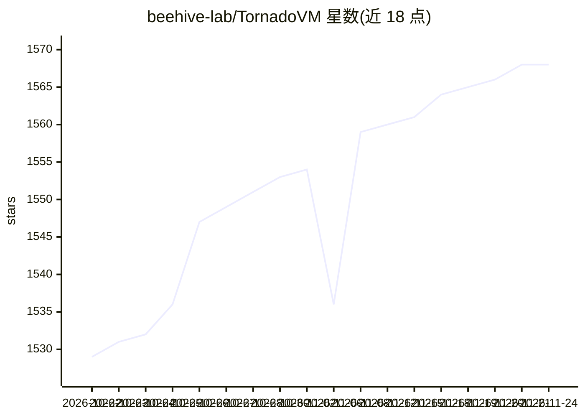

# beehive-lab/TornadoVM

⭐ 1,568 · Java · Apache-2.0 · 推送 2026-11-23 · [GitHub](https://github.com/beehive-lab/TornadoVM) · [官网](https://www.tornadovm.org) · 组织维护

**让 Java 代码 JIT 编译后运行在 GPU 上的编程框架**

面向 Java 开发者的 GPU 编程框架，兼容 JDK 21–27，运行时将 Java 字节码 JIT 编译为 NVIDIA CUDA、AMD HIP、OpenCL C 与 Apple Metal 代码，支持 NVIDIA/AMD/Intel/Apple Silicon GPU、集成显卡与多核 CPU。提供三种粒度的 Java API（@Parallel、KernelContext、TileContext）构建 TaskGraph；在 NVIDIA 硬件上可从纯 Java 调用 cuBLAS/cuFFT/cuDNN/cuDF 等库并暴露 Tensor Core 指令。安装依赖 JDK 21+、GCC ≥13 及对应 GPU 驱动/工具包；AMD HIP 为实验性。

## 筛选速览

| 维度 | 判定 | 备注 |
|---|---|---|
| AI 角色 | `ai-enhanced` | 去掉 AI 部分产品仍成立 |
| 许可风险 | `permissive` | Apache-2.0 |
| 部署形态 | `None` |  |
| 模型依赖 | — | README 未给出锁定关系 |
| 硬件要求 | — | 无带数字的原话,不猜 |
| 安装摩擦 | `high` | 编译与系统依赖俱全 |
| 成熟度 | — | 结构信号不足 |

## 能力要点

- 运行时将 Java 字节码 JIT 编译为 CUDA/HIP/OpenCL/Metal 内核
- 三种 API（@Parallel/KernelContext/TileContext）可混合在同一 TaskGraph
- 纯 Java 调用 cuBLAS/cuFFT/cuDNN/cuDF 及 Tensor Core mma.sync 指令
- 支持 Project Leyden AOT 缓存与 GraalVM native image 启动

## 适用场景

- 用 Java 为 NVIDIA GPU 编写并运行矩阵运算等并行内核
- 在 Java 应用中调用 CUDA 库做深度学习原语（如 flash attention）
- 加速机器学习、计算机视觉、物理仿真等 Java 计算负载

## 场景标签

 · 领域:系统/编程框架

## 证据(README 行号)

> L5: TornadoVM is a GPU programming framework for Java that works with JDK 21+ (currently JDK 21-27). It JIT-compiles Jav
> L124: TornadoVM is used to accelerate machine learning and deep learning, computer vision, physics simulations, financia
> L130: - min **JDK 21** — `JAVA_HOME` must point to it

## 星数曲线

2026-10-22 1,529 → 2026-11-24 1,568（+39）

---
*卡片 v1 · prompt 1.4 · 生成 2026-11-23 · 置信度 high · 依据 README sha `576b88911087` · [字段定义](../../DATASET.md)*
