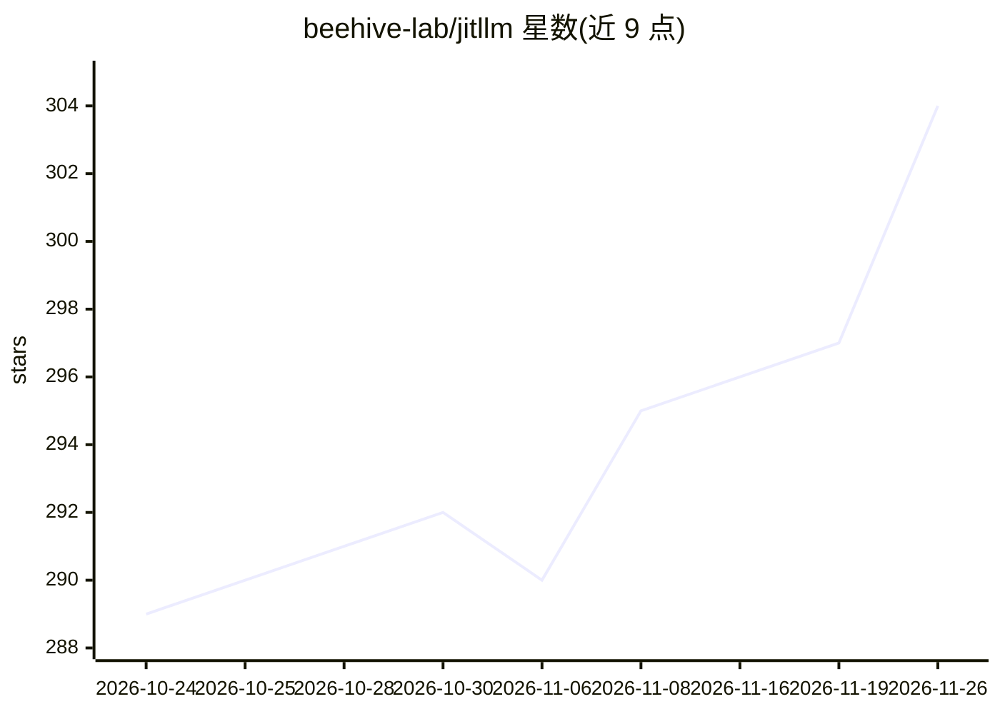

# beehive-lab/jitllm

⭐ 304 · Java · Apache-2.0 · 推送 2026-11-25 · [GitHub](https://github.com/beehive-lab/jitllm) · [官网](https://beehive-lab.github.io/jitllm/) · 组织维护

**JVM 上的 GPU LLM 推理与服务引擎**

纯 Java 编写的 JVM 原生 LLM 推理与服务引擎，通过 TornadoVM 在运行时将 transformer 内核 JIT 编译到 CUDA、OpenCL、HIP 或 Apple Metal，同一 jar 可在 NVIDIA/Intel/AMD/Apple Silicon GPU 上运行。读取 GGUF 模型文件，提供 CLI（run/chat/serve/bench）、Java API、OpenAI 兼容 HTTP 服务，并作为 LangChain4j 模型提供者与 Quarkus 推理引擎集成。支持多 GPU 层间切分与 NCCL 传输，需 JDK 21/22+ 与 GPU 厂商驱动。

## 筛选速览

| 维度 | 判定 | 备注 |
|---|---|---|
| AI 角色 | `ai-ecosystem` | LLM/agent 周边工具 |
| 许可风险 | `permissive` | Apache-2.0 |
| 部署形态 | `None` |  |
| 模型依赖 | — | README 未给出锁定关系 |
| 硬件要求 | — | 无带数字的原话,不猜 |
| 安装摩擦 | `medium` | 含编译或系统依赖之一 |
| 成熟度 | — | 结构信号不足 |

## 能力要点

- TornadoVM JIT 编译 Java 内核至 CUDA/OpenCL/HIP/Metal，无 JNI
- OpenAI 兼容 HTTP 服务（/v1/chat/completions 等，支持流式与连续批处理）
- 支持 Qwen、Gemma、GLM、Llama 3、DeepSeek-R1-Distill 等多模型家族的 GGUF 量化文件
- 多 GPU 层间切分（--tensor-split）与 NCCL 传输

## 适用场景

- 在 Java 服务中嵌入本地 GPU 推理能力
- 通过 OpenAI 兼容 API 对内网提供 LLM 服务
- 在 Apple Silicon 或 AMD GPU 上运行 GGUF 模型
- 将超大模型切分到多张 GPU 上运行

## 场景标签

`推理引擎` · 领域:训练与推理

## 证据(README 行号)

> L16: **jitLLM** is a JVM-native LLM inference and serving engine. You write and ship plain Java; **TornadoVM** JIT-compi
> L20: Serve it behind an **OpenAI-compatible API**, embed it in **LangChain4j** or **Quarkus**, or run it from the CLI in
> L28: - ⚡ **Built to serve.** OpenAI-compatible HTTP server (`jitllm serve`) with streaming, batched prefill on tensor co

## 星数曲线

2026-10-24 289 → 2026-11-26 304（+15）

---
*卡片 v1 · prompt 1.4 · 生成 2026-11-26 · 置信度 high · 依据 README sha `8f6fa0a33f72` · [字段定义](../../DATASET.md)*
