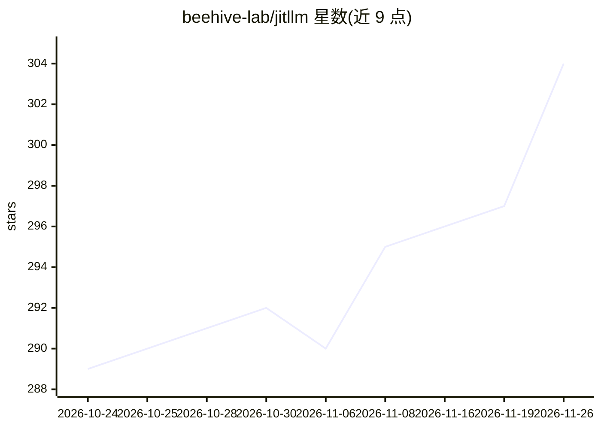

# beehive-lab/jitllm

⭐ 304 · Java · Apache-2.0 · 推送 2026-11-25 · [GitHub](https://github.com/beehive-lab/jitllm) · [官网](https://beehive-lab.github.io/jitllm/) · 组织维护

**JVM 上的 GPU LLM 推理与 OpenAI 兼容服务引擎**

纯 Java 的 JVM 原生 LLM 推理与 serving 引擎：Transformer 内核以 Java 编写，由 TornadoVM 在运行时 JIT 编译到 CUDA、OpenCL 或 Apple Metal，同一 jar 可在 NVIDIA、Intel、AMD、Apple Silicon 上运行，无需 JNI 或按 GPU 重新构建。提供 OpenAI 兼容 HTTP 服务器（/v1/chat/completions、/v1/completions）、llama-bench 风格基准测试、CUDA 张量核批量 prefill 与批量解码，并以官方 model provider 集成 LangChain4j 与 Quarkus。读取 GGUF 格式模型，需 JDK 21/22+ 与 TornadoVM SDK。

## 筛选速览

| 维度 | 判定 | 备注 |
|---|---|---|
| AI 角色 | `ai-ecosystem` | LLM/agent 周边工具 |
| 许可风险 | `permissive` | Apache-2.0 |
| 部署形态 | `None` |  |
| 模型依赖 | — | README 未给出锁定关系 |
| 硬件要求 | — | 无带数字的原话,不猜 |
| 安装摩擦 | `high` | 编译与系统依赖俱全 |
| 成熟度 | — | 结构信号不足 |

## 能力要点

- TornadoVM 运行时 JIT 到 CUDA/OpenCL/Metal，一份 jar 跨 NVIDIA/Intel/AMD/Apple Silicon
- OpenAI 兼容 HTTP 服务器（流式、/v1/models 报告上下文长度）
- CUDA 张量核批量 prefill 与批量解码（实验性 continuous-batching）
- 官方 LangChain4j provider（v1.7.1+）与 Quarkus 推理引擎集成

## 适用场景

- 在 JVM 技术栈中运行 GGUF 模型的 GPU 推理
- 将 Llama/Mistral/Qwen 等模型以 OpenAI 兼容 API 暴露给 Java 应用
- 通过 LangChain4j/Quarkus 嵌入推理能力
- 跨 NVIDIA、Apple 等多类 GPU 部署同一模型

## 场景标签

`推理引擎` · 领域:训练与推理

## 证据(README 行号)

> L16: **jitLLM** is a JVM-native LLM inference and serving engine. You write and ship plain Java; **TornadoVM** JIT-compi
> L20: Serve it behind an **OpenAI-compatible API**, embed it in **LangChain4j** or **Quarkus**, or run it from the CLI in
> L45: - 🌐 **OpenAI-compatible server** — `jitllm serve` exposes `/v1/chat/completions` and `/v1/completions` with streami

## 星数曲线

2026-10-24 289 → 2026-11-26 304（+15）

---
*卡片 v1 · prompt 1.4 · 生成 2026-11-25 · 置信度 high · 依据 README sha `53d9d9b9b7a6` · [字段定义](../../DATASET.md)*
