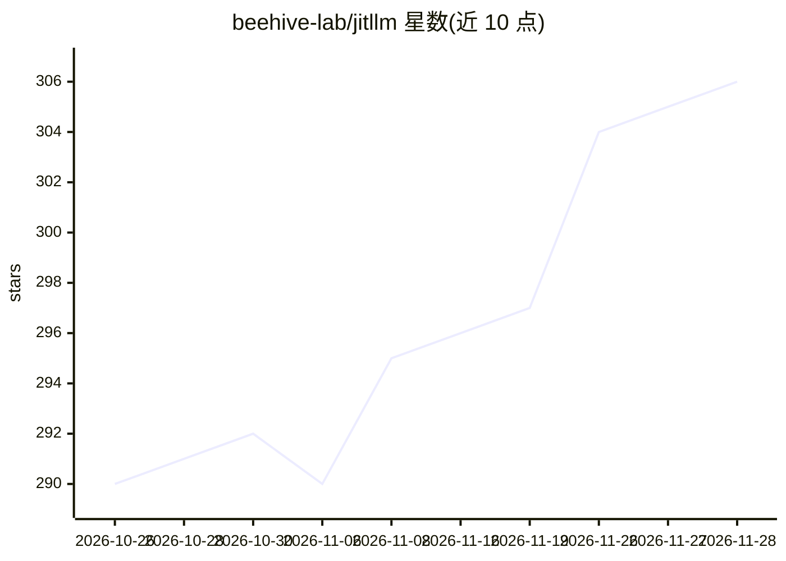

# beehive-lab/jitllm

⭐ 306 · Java · Apache-2.0 · 推送 2026-11-27 · [GitHub](https://github.com/beehive-lab/jitllm) · [官网](https://beehive-lab.github.io/jitllm/) · 组织维护

**给 JVM 开发者的 GPU 上 LLM 推理与服务引擎**

纯 Java 编写的 JVM 原生 LLM 推理与服务引擎：Transformer 核由 Java 编写，经 TornadoVM 在运行时 JIT 编译为 CUDA、OpenCL 或 Metal，无需 JNI 与逐 GPU 原生重编译。读取 GGUF 模型文件，按模型家族加载，提供 CLI（run/chat/serve/bench）与 Java API；serve 暴露 OpenAI 兼容 HTTP 接口，支持流式、批式 prefill、多 GPU 层拆分与 NCCL 传输。可作为 LangChain4j 模型提供者与 Quarkus LangChain4j 推理引擎接入。需 JDK 21/22+ 与 GPU 厂商驱动。

## 筛选速览

| 维度 | 判定 | 备注 |
|---|---|---|
| AI 角色 | `ai-ecosystem` | LLM/agent 周边工具 |
| 许可风险 | `permissive` | Apache-2.0 |
| 部署形态 | `None` |  |
| 模型依赖 | — | README 未给出锁定关系 |
| 硬件要求 | — | 无带数字的原话,不猜 |
| 安装摩擦 | `medium` | 含编译或系统依赖之一 |
| 成熟度 | — | 结构信号不足 |

## 能力要点

- 同一 jar 在 NVIDIA、Intel、AMD、Apple Silicon GPU 上运行，后端经 TornadoVM 自动检测
- OpenAI 兼容 HTTP 服务（/v1/chat/completions 等），支持流式与连续批处理（实验性）
- 支持多 GPU 层级拆分（--tensor-split）与 NCCL 跨卡传输
- 官方 LangChain4j 模型提供者与 Quarkus LangChain4j 推理引擎

## 适用场景

- 在 Java 应用中直接加载 GGUF 模型做本地文本生成
- 用 Java 微服务对外提供 OpenAI 兼容的 LLM API
- 将大模型按层拆分到多张 GPU 上运行

## 场景标签

`推理引擎` · 领域:训练与推理

## 证据(README 行号)

> L16: **jitLLM** is a JVM-native LLM inference and serving engine. You write and ship plain Java; **TornadoVM** JIT-compi
> L20: Serve it behind an **OpenAI-compatible API**, embed it in **LangChain4j** or **Quarkus**, or run it from the CLI in
> L28: - ⚡ **Built to serve.** OpenAI-compatible HTTP server (`jitllm serve`) with streaming, batched prefill on tensor co

## 星数曲线

2026-10-26 290 → 2026-11-28 306（+16）

---
*卡片 v1 · prompt 1.4 · 生成 2026-11-28 · 置信度 high · 依据 README sha `7d7ecc61d210` · [字段定义](../../DATASET.md)*
