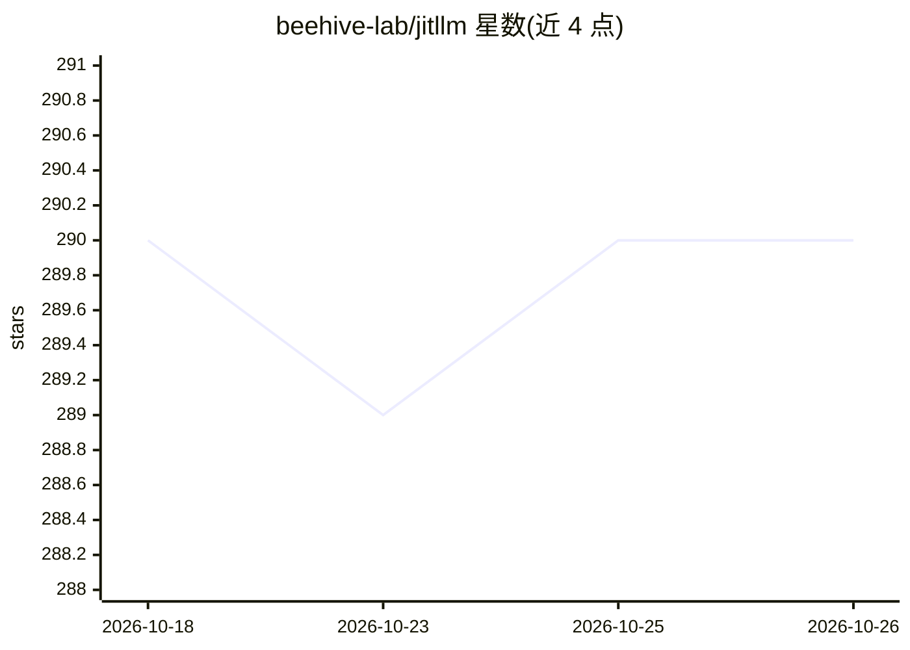

# beehive-lab/jitllm

⭐ 290 · Java · MIT · 推送 2026-10-24 · [GitHub](https://github.com/beehive-lab/jitllm) · [官网](https://beehive-lab.github.io/jitllm/) · 组织维护

**JVM 上的 LLM 推理与服务引擎：纯 Java 经 TornadoVM JIT 到任意 GPU**

面向 JVM 开发者的 LLM 推理引擎与 serving 框架：transformer kernel 以 Java 编写，由 TornadoVM 在运行时 JIT 编译为 CUDA、OpenCL 或 Apple Metal，同一 jar 可运行于 NVIDIA/Intel/AMD/Apple Silicon GPU。支持 GGUF 格式的 Llama 3、Mistral、Qwen、Granite、DeepSeek-R1-Distill 等模型，提供 OpenAI 兼容 HTTP 服务、CLI、JBang 一行运行，并自 v1.7.1 起作为 LangChain4j 官方 provider。限制：依赖 TornadoVM SDK 与 Java 21+，服务端功能标注为 preview。

## 筛选速览

| 维度 | 判定 | 备注 |
|---|---|---|
| AI 角色 | `ai-ecosystem` | LLM/agent 周边工具 |
| 许可风险 | `permissive` | MIT |
| 部署形态 | `None` |  |
| 模型依赖 | — | README 未给出锁定关系 |
| 硬件要求 | — | 无带数字的原话,不猜 |
| 安装摩擦 | `high` | 编译与系统依赖俱全 |
| 成熟度 | `idea` | |

## 能力要点

- TornadoVM 运行时 JIT 编译到 CUDA/OpenCL/Metal，无需 JNI 或按 GPU 重建
- OpenAI 兼容服务（/v1/chat/completions 等）与流式输出
- CUDA tensor-core 批量 prefill（F16/Q8_0/Q4_0/Q4_K）与 llama-bench 式基准测试
- 官方 LangChain4j provider 与 Quarkus 推理引擎集成

## 适用场景

- 在 Java/Quarkus 应用内嵌入 GPU 加速的 LLM 推理，无需 JNI 或第二工具链
- 用 OpenAI 兼容 API 在本地 GPU 上服务 GGUF 模型
- 跨 NVIDIA/AMD/Intel/Apple 硬件复用同一份 Java 代码运行模型

## 场景标签

`推理引擎` · 领域:训练与推理

## 证据(README 行号)

> L17: **jitLLM** is a JVM-native LLM inference and serving engine. You write and ship plain Java; **TornadoVM** JIT-compi
> L21: Serve it behind an **OpenAI-compatible API**, embed it in **LangChain4j** or **Quarkus**, or run it from the CLI in
> L46: - 🌐 **OpenAI-compatible server** — `jitllm serve` exposes `/v1/chat/completions` and `/v1/completions` with streami

## 星数曲线

2026-10-18 290 → 2026-10-26 290（+0）

---
*卡片 v1 · prompt 1.4 · 生成 2026-10-22 · 置信度 high · 依据 README sha `6ed9e40527c7` · [字段定义](../../DATASET.md)*
