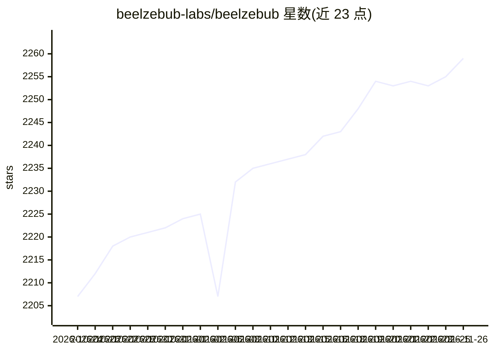

# beelzebub-labs/beelzebub

⭐ 2,259 · Go · GPL-3.0 · 推送 2026-11-23 · [GitHub](https://github.com/beelzebub-labs/beelzebub) · [官网](https://docs.beelzebub.ai) · 组织维护

**给安全团队用的开源蜜罐欺骗框架，LLM 驱动诱饵响应**

Beelzebub 是一个开源欺骗框架：在 YAML 中定义 SSH、HTTP、TCP、TELNET、MCP 等协议的诱饵服务、路由与响应规则，捕获攻击者的命令、HTTP 请求与会话上下文作为调查证据。响应可走静态处理器，也可配置 LLM 提供商生成自适应回复以延长交互；支持 Go 插件扩展。事件输出到本地日志、RabbitMQ 或可选的 Beelzebub Platform，并支持 Prometheus 指标。部署方式包括本地 Go 二进制、Docker Compose 与 Kubernetes Helm。

## 筛选速览

| 维度 | 判定 | 备注 |
|---|---|---|
| AI 角色 | `ai-enhanced` | 去掉 AI 部分产品仍成立 |
| 许可风险 | `viral` | GPL-3.0 |
| 部署形态 | `self-host` | docker 或自建部署 |
| 模型依赖 | — | README 未给出锁定关系 |
| 硬件要求 | — | 无带数字的原话,不猜 |
| 安装摩擦 | `low` | 无编译、无系统依赖或容器化 |
| 成熟度 | — | 结构信号不足 |

## 能力要点

- 支持 SSH/HTTP/TCP/TELNET/MCP 协议的诱饵服务，附 18 个示例配置
- LLM 驱动的诱饵可生成自适应响应，静态处理器无需配置提供商
- MCP 诱饵暴露 bait 工具，可在 agent 测试中记录 prompt-injection 尝试
- 事件输出支持日志、RabbitMQ、Platform 报告与 Prometheus 指标

## 适用场景

- 在企业网络中部署诱饵服务并记录攻击者行为
- 配置 LLM 诱饵与攻击者进行持续交互以收集证据
- 对 agent 环境做受控测试，观察可疑的 MCP 工具调用

## 场景标签

`网络安全` · 领域:学习与行业

## 证据(README 行号)

> L1: Beelzebub — open-source deception framework
> L35: Define services and rules in YAML, validate the configuration, and start the runtime. Trusted Go plugins are compil
> L37: The framework supports **SSH, HTTP, TCP, TELNET, and MCP**. MCP decoys expose bait tools that make suspicious invoc

## 星数曲线

2026-10-24 2,207 → 2026-11-26 2,259（+52）

---
*卡片 v1 · prompt 1.4 · 生成 2026-11-23 · 置信度 high · 依据 README sha `44d603fdf482` · [字段定义](../../DATASET.md)*
